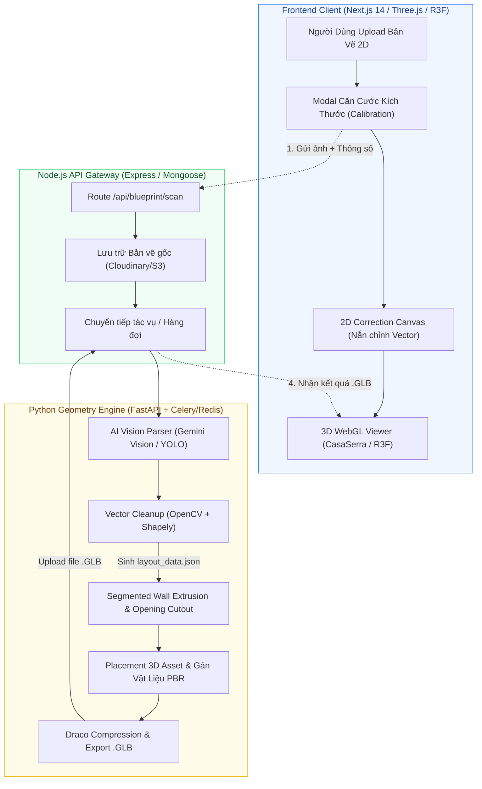
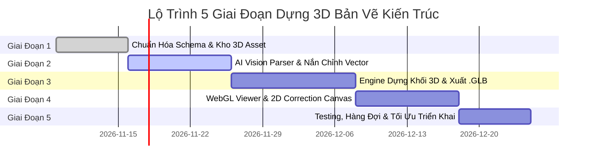

# 🏛️ ĐẶC TẢ THIẾT KẾ HỆ THỐNG & DANH MỤC STORIES
## ENGINE TỰ ĐỘNG DỰNG MÔ HÌNH 3D TỪ BẢN VẼ 2D (2D-TO-3D BLUEPRINT RECONSTRUCTION)

> **Dự án:** PickMe3D  
> **Người phụ trách thiết kế & triển khai:** Nguyễn Hiệu Thuận (`Goncodex911`)  
> **Tài liệu tham chiếu:** [THUAN_USER_STORIES.md](file:///d:/CODE/PickMe3D/THUAN_USER_STORIES.md) · [FEATURE_PROPOSALS.md](file:///d:/CODE/PickMe3D/FEATURE_PROPOSALS.md)  
> **Phiên bản:** 1.0 (Ngày ban hành: 06/11/2026)

---

## 📑 MỤC LỤC
1. [Kiến Trúc Hệ Thống Tổng Quan & Luồng Dữ Liệu](#1-kiến-trúc-hệ-thống-tổng-quan--luồng-dữ-liệu)
2. [Yêu Cầu Chuẩn Hóa Dữ Liệu Đầu Vào Từ Người Dùng](#2-yêu-cầu-chuẩn-hóa-dữ-liệu-đầu-vào-từ-người-dùng)
3. [Đặc Tả Chuẩn Dữ Liệu Trung Gian (layout_data.json Schema)](#3-đặc-tả-chuẩn-dữ-liệu-trung-gian-layout_datajson-schema)
4. [Danh Mục Modal & Giao Diện Cần Bổ Sung (Frontend)](#4-danh-mục-modal--giao-diện-cần-bổ-sung-frontend)
5. [Cấu Hình Môi Trường & Hạ Tầng Kỹ Thuật Cần Cung Cấp](#5-cấu-hình-môi-trường--hạ-tầng-kỹ-thuật-cần-cung-cấp)
6. [Chi Tiết Phân Rã Stories & Tasks Theo 5 Giai Đoạn (Agile)](#6-chi-tiết-phân-rã-stories--tasks-theo-5-giai-đoạn-agile)

---

## 1. KIẾN TRÚC HỆ THỐNG TỔNG QUAN & LUỒNG DỮ LIỆU

Hệ thống kết hợp mô hình **Node.js Core Gateway** và **Python Geometry Microservice** để tối ưu hóa năng lực tính toán đại số hình học:



---

## 2. YÊU CẦU CHUẨN HÓA DỮ LIỆU ĐẦU VÀO TỪ NGƯỜI DÙNG

Để AI và Engine hình học tái tạo chính xác 100% không gian 3D mà không bị méo tỉ lệ, hệ thống yêu cầu dữ liệu đầu vào tuân thủ các tiêu chuẩn sau:

### 2.1. Yêu Cầu Về Tệp Ảnh Bản Vẽ (Image Blueprint Requirements)
* **Định dạng hợp lệ:** `PNG`, `JPG`, `JPEG`, `WEBP`, `PDF` (vector hoặc scan trang đơn).
* **Độ phân giải tối thiểu:** $1200 \times 1200\text{ px}$; tối đa $4000 \times 4000\text{ px}$. Dung lượng tối đa: $15\text{ MB}$.
* **Chất lượng góc chụp:**
  - Đối với ảnh scan CAD: Đạt độ nét chuẩn nét cắt (Cut lines) rõ ràng.
  - Đối với ảnh chụp điện thoại bản vẽ giấy: Góc chụp vuông góc thẳng đứng từ trên xuống (Top-down view), ánh sáng đồng đều, không bị lóa đèn flash làm mất nét tường.

### 2.2. Thông Số Căn Cước Thực Tế (Calibration Metric Data)
Người dùng **bắt buộc cung cấp ít nhất 1 trong 2 tham số định chuẩn** để chuyển đổi từ đơn vị Pixel sang Mét ($1\text{ px} = k\text{ mét}$):
1. **Phương pháp A (Khuyến nghị):** Nhập 2 kích thước biên thực tế:
   - **Chiều rộng mặt tiền ($W$):** tính bằng mét (ví dụ: $13.1\text{ m}$).
   - **Chiều sâu công trình ($L$):** tính bằng mét (ví dụ: $10.65\text{ m}$).
2. **Phương pháp B (Thước đo tương tác - Calibration Ruler):** Kéo một đoạn thẳng trên bản vẽ và nhập chiều dài thực (ví dụ: kéo dọc theo cạnh tường phòng khách và gõ $5.0\text{ m}$).

### 2.3. Các Tham Số Kiến Trúc Tùy Chọn
* **Chiều cao tầng (Ceiling Height):** Mặc định $3.3\text{ m}$ (cho phép tùy chỉnh $2.7\text{ m} - 4.5\text{ m}$).
* **Độ dày tường bao ngoài (Exterior Wall Thickness):** Mặc định $0.22\text{ m}$ ($220\text{ mm}$).
* **Độ dày tường ngăn trong (Interior Wall Thickness):** Mặc định $0.11\text{ m}$ ($110\text{ mm}$).
* **Cao độ bậu cửa sổ (Window Sill Height):** Mặc định $0.9\text{ m}$ so với mặt sàn.
* **Chiều cao cửa đi (Door Height):** Mặc định $2.2\text{ m}$.

---

## 3. ĐẶC TẢ CHUẨN DỮ LIỆU TRUNG GIAN (`layout_data.json` SCHEMA)

> [!IMPORTANT]
> **Hệ quy chiếu không gian (Coordinate System):**
> Chuẩn **Right-Handed Y-up** (chuẩn glTF 2.0 / Three.js).
> - Trục $X$: Chiều ngang mặt bằng (từ trái qua phải).
> - Trục $Z$: Chiều sâu mặt bằng (từ trên xuống dưới trong không gian 2D, tương ứng chiều sâu trong 3D).
> - Trục $Y$: Trục cao độ thẳng đứng ($Y = 0$ là mặt sàn, $Y = 3.3$ là mặt trần).
> - Đơn vị tính toàn bộ: **Mét (meter)**.

```json
{
  "$schema": "https://pickme3d.com/schemas/layout_data.v1.json",
  "metadata": {
    "project_id": "proj_bp_9941a",
    "project_name": "Biệt Thự Vườn Hiện Đại",
    "units": "meters",
    "coordinate_system": "right_handed_y_up",
    "scale_pixel_to_meter": 0.0125,
    "dimensions": {
      "width": 13.1,
      "length": 10.65,
      "default_ceiling_height": 3.3,
      "exterior_wall_thickness": 0.22,
      "interior_wall_thickness": 0.11
    },
    "original_blueprint_url": "https://res.cloudinary.com/pickme3d/image/upload/v1/blueprints/blueprint_01.jpg"
  },
  "walls": [
    {
      "id": "wall_ext_01",
      "type": "exterior",
      "start": [-6.55, -5.325],
      "end": [6.55, -5.325],
      "thickness": 0.22,
      "height": 3.3,
      "openings": ["opening_door_main", "opening_win_01"]
    },
    {
      "id": "wall_int_01",
      "type": "interior",
      "start": [0.0, -5.325],
      "end": [0.0, 2.5],
      "thickness": 0.11,
      "height": 3.3,
      "openings": ["opening_door_room1"]
    }
  ],
  "openings": [
    {
      "id": "opening_door_main",
      "type": "door",
      "wall_id": "wall_ext_01",
      "center": [0.0, -5.325],
      "width": 1.8,
      "height": 2.4,
      "sill_height": 0.0,
      "door_type": "double_glass_swing"
    },
    {
      "id": "opening_win_01",
      "type": "window",
      "wall_id": "wall_ext_01",
      "center": [4.2, -5.325],
      "width": 1.6,
      "height": 1.5,
      "sill_height": 0.9,
      "window_type": "sliding_glass"
    }
  ],
  "rooms": [
    {
      "id": "room_living",
      "name": "Living Room",
      "vietnamese_name": "Phòng Khách",
      "category": "living",
      "polygon": [
        [-6.55, -5.325],
        [0.0, -5.325],
        [0.0, 1.2],
        [-6.55, 1.2]
      ],
      "area_m2": 42.8,
      "materials": {
        "floor": "marble_cream_glossy",
        "ceiling": "plaster_white_matte",
        "walls": "wall_paint_warm_white"
      }
    }
  ],
  "furniture_assets": [
    {
      "id": "furn_sofa_01",
      "asset_model_id": "sofa_modern_3seat",
      "category": "living",
      "position": [-3.2, 0.0, -2.1],
      "rotation_deg": 90.0,
      "scale": [1.0, 1.0, 1.0],
      "glb_url": "https://assets.pickme3d.com/models/furniture/sofa_modern_3seat.glb"
    },
    {
      "id": "furn_toilet_01",
      "asset_model_id": "toilet_wall_hung",
      "category": "bath",
      "position": [4.5, 0.0, 3.2],
      "rotation_deg": 180.0,
      "scale": [1.0, 1.0, 1.0],
      "glb_url": "https://assets.pickme3d.com/models/furniture/toilet_wall_hung.glb"
    }
  ]
}
```

---

## 4. DANH MỤC MODAL & GIAO DIỆN CẦN BỔ SUNG (FRONTEND)

| TT | Tên Modal / Thành Phần Giao Diện | File Dự Kiến | Mô Tả & Chức Năng Chính |
| :---: | :--- | :--- | :--- |
| **M1** | **Blueprint Calibration Modal** | [`frontend/components/blueprint/BlueprintInputModal.tsx`](file:///d:/CODE/PickMe3D/frontend/components/blueprint/BlueprintInputModal.tsx) | Tiếp nhận file ảnh, cho phép nhập kích thước mặt tiền $W$, chiều sâu $L$, chiều cao trần và công cụ kéo thước tham chiếu 2D trực quan. |
| **M2** | **2D Vector Correction Canvas** | `frontend/components/blueprint/VectorCorrectionCanvas.tsx` | Hiển thị các nét tường, cửa AI nhận dạng đè (overlay) lên ảnh gốc. Cho phép người dùng kéo nắn lại nút điểm tường (Vertex Editing) trước khi bấm "Dựng 3D". |
| **M3** | **Floor & Layer Visibility Manager** | `frontend/components/blueprint/FloorLayerToolbar.tsx` | Thanh công cụ nổi trên 3D: Nút chuyển tầng (Tầng 1, Tầng 2), nút ẩn/hiện mái nhà, ẩn/hiện trần nhà và bật/tắt toàn bộ nội thất để dễ quan sát layout. |
| **M4** | **3D Navigation & Walkthrough HUD** | Nâng cấp trong [`CasaSerraViewer.tsx`](file:///d:/CODE/PickMe3D/frontend/components/blueprint/CasaSerraViewer.tsx) | Bộ điều khiển góc nhìn: Chế độ Xoay (Orbit), Góc nhìn Isometric từ trên xuống, và Chế độ Bước đi góc nhìn thứ nhất (WASD + Chuột). |
| **M5** | **Asset Placement & Swap Modal** | `frontend/components/blueprint/FurnitureSwapModal.tsx` | Bấm vào bất kỳ món đồ 3D nào để đổi model khác trong thư viện (ví dụ: đổi từ Giường gỗ sang Giường da bọc nệm). |
| **M6** | **3D & 2D Export Modal** | `frontend/components/blueprint/ExportSceneModal.tsx` | Hộp thoại cấu hình xuất tệp: Tùy chọn tải về `.GLB` (kèm nén Draco), tệp CAD `.DXF` 2D và bảng bóc tách diện tích phòng `.CSV`. |

---

## 5. CẤU HÌNH MÔI TRƯỜNG & HẠ TẦNG KỸ THUẬT CẦN CUNG CẤP

### 5.1. Biến Môi Trường (Environment Variables)

#### 🔹 Cấu hình Backend Node.js / Next.js (`.env`):
```env
# AI Vision Analysis (Gemini 2.0 Flash)
GEMINI_API_KEY="AIzaSy..."

# Python Geometry Service Endpoint
PYTHON_GEOMETRY_SERVICE_URL="http://localhost:8001"
GEOMETRY_SERVICE_TIMEOUT_MS=60000

# Cloud Media & 3D Model Storage (Cloudinary hoặc AWS S3/Cloudflare R2)
CLOUDINARY_CLOUD_NAME="pickme3d"
CLOUDINARY_API_KEY="your_api_key"
CLOUDINARY_API_SECRET="your_api_secret"

# Public 3D Asset Base URL
NEXT_PUBLIC_ASSET_CDN_URL="https://assets.pickme3d.com"
```

#### 🔹 Cấu hình Python Geometry Microservice (`python-engine/.env`):
```env
HOST=0.0.0.0
PORT=8001
CORS_ORIGINS=["http://localhost:3000","http://localhost:5000"]
DRACO_COMPRESSION_LEVEL=7
REDIS_URL="redis://localhost:6379/0"
CELERY_CONCURRENCY=4
```

### 5.2. Kho Thư Viện 3D Asset Chuẩn Hóa Ban Đầu (`assets/models/furniture/`)
Quy chuẩn cho toàn bộ file `.glb` trong thư viện:
* **Dung lượng:** Dưới $1.5\text{ MB}$/file.
* **Lưới (Mesh):** Dưới 15,000 polygons, đã triangulate.
* **Gốc tọa độ Pivot Point:** Đặt chuẩn xác tại $(0, 0, 0)$ ở tâm đáy chân vật thể.
* **Danh mục 8 Assets nền tảng cốt lõi cần chuẩn bị:**
  1. `bed_queen_modern.glb`: Giường đôi $1.8\text{ m} \times 2.0\text{ m} \times 0.9\text{ m}$.
  2. `sofa_modern_3seat.glb`: Sofa văng 3 chỗ $2.2\text{ m} \times 0.9\text{ m} \times 0.8\text{ m}$.
  3. `dining_table_6chairs.glb`: Bàn ăn 6 ghế $1.6\text{ m} \times 0.9\text{ m} \times 0.75\text{ m}$.
  4. `toilet_wall_hung.glb`: Bồn cầu treo tường $0.4\text{ m} \times 0.6\text{ m} \times 0.5\text{ m}$.
  5. `sink_cabinet_bath.glb`: Bồn rửa mặt + tủ gương $0.8\text{ m} \times 0.5\text{ m} \times 1.8\text{ m}$.
  6. `kitchen_counter_island.glb`: Đảo bếp kèm bếp từ $2.4\text{ m} \times 0.8\text{ m} \times 0.85\text{ m}$.
  7. `door_single_wood.glb`: Cửa gỗ 1 cánh mở xoay $0.9\text{ m} \times 2.2\text{ m}$.
  8. `window_sliding_2pane.glb`: Cửa sổ lùa 2 cánh nhôm kính $1.6\text{ m} \times 1.5\text{ m}$.

---

## 6. CHI TIẾT PHÂN RÃ STORIES & TASKS THEO 5 GIAI ĐOẠN (AGILE)



---

### 🟢 GIAI ĐOẠN 1: Chuẩn Hóa Schema & Xây Dựng Kho Asset 3D

#### 📌 Story 1.1: Định nghĩa chuẩn cấu trúc dữ liệu `layout_data.json` và Schema Validator
- **Mã:** `STORY-THUAN-BP01`
- **Mô tả:**  
  *Là một* Kỹ sư phần mềm PickMe3D,  
  *Tôi muốn* có một bộ định nghĩa TypeScript Interface và JSON Schema hoàn chỉnh cho dữ liệu mặt bằng,  
  *Để* các service Frontend, AI Vision và 3D Engine có cùng một tiếng nói chung, không bị sai lệch kiểu dữ liệu.
- **Tiêu chí chấp nhận (AC):**
  - [x] Nâng cấp file [`frontend/lib/floorplan-types.ts`](file:///d:/CODE/PickMe3D/frontend/lib/floorplan-types.ts) hỗ trợ đầy đủ `LayoutData`, `WallSegment`, `OpeningSpec`, `RoomPolygon`, `FurniturePlacement`.
  - [x] Viết hàm validator (dùng `zod` hoặc JSON Schema) kiểm tra tính hợp lệ của tọa độ trước khi đưa vào render.
  - [x] Có bộ tài liệu mô tả chi tiết hệ tọa độ Right-Handed Y-up và đơn vị đo mét.
- **Công việc (Tasks):**
  - [x] **Task 1.1.1:** Viết TypeScript schema trong `floorplan-types.ts` và export các Zod schemas kiểm tra dữ liệu.
  - [x] **Task 1.1.2:** Tạo bộ file mẫu `layout_data_demo_villa.json` và `layout_data_demo_apartment.json` để phục vụ mock test.

#### 📌 Story 1.2: Xây dựng Thư Viện 3D Asset Nội Thất & Khung Cửa Chuẩn Hóa
- **Mã:** `STORY-THUAN-BP02`
- **Mô tả:**  
  *Là một* Người dùng xem 3D,  
  *Tôi muốn* các đồ vật nội thất được đặt tự động vào đúng cao độ mặt sàn, kích thước chuẩn nhân trắc học,  
  *Để* căn nhà sinh ra trông thực tế, sống động và không bị đồ vật chìm dưới sàn hay lơ lửng giữa phòng.
- **Tiêu chí chấp nhận (AC):**
  - [x] 8 models `.glb` cơ bản được lưu trong `frontend/public/models/furniture/` hoặc CDN.
  - [x] 100% models có Pivot Point tại $(0, 0, 0)$ ở tâm chân đáy.
  - [x] Dung lượng mỗi file $< 1.5\text{ MB}$, texture được tối ưu hóa tối đa $1024 \times 1024$.
- **Công việc (Tasks):**
  - [x] **Task 1.2.1:** Kiểm tra, tối ưu hóa vertex và set pivot point cho 8 file GLB mẫu.
  - [x] **Task 1.2.2:** Viết catalog metadata `furniture-catalog.json` chứa id, tên tiếng Việt, kích thước bounding box `[w, h, d]` và URL file.

---

### 🟢 GIAI ĐOẠN 2: Module AI Vision & Nắn Chỉnh Vector (2D Vectorization)

#### 📌 Story 2.1: Prompt Engineering Gemini 2.0 Flash Vision Trích Xuất Vector Tường & Cửa
- **Mã:** `STORY-THUAN-BP03`
- **Mô tả:**  
  *Là một* Người dùng tải ảnh bản vẽ 2D,  
  *Tôi muốn* AI tự động phân tích và trích xuất danh sách các đoạn tường, cửa đi, cửa sổ và diện tích phòng dưới dạng tọa độ vector,  
  *Để* tôi không cần phải tự vẽ lại bằng tay từ đầu.
- **Tiêu chí chấp nhận (AC):**
  - [x] Cải tiến hàm `scanBlueprintWithAI` trong [`floorplan-ai-scanner.ts`](file:///d:/CODE/PickMe3D/frontend/lib/floorplan-ai-scanner.ts) gửi ảnh kèm prompt chuyên sâu kiến trúc.
  - [x] AI trả về đúng cấu trúc JSON chứa mảng `walls`, `openings`, `rooms` theo tỉ lệ tương quan với kích thước thực tế được cung cấp.
  - [x] Tỷ lệ parse thành công cấu trúc phòng đạt $> 90\%$ trên các bản vẽ tiêu chuẩn.
- **Công việc (Tasks):**
  - [x] **Task 2.1.1:** Xây dựng System Prompt kiến trúc chuyên dụng với Few-shot examples mẫu.
  - [x] **Task 2.1.2:** Viết parser chuyển đổi từ tọa độ normalized $(0.0 \to 1.0)$ sang tọa độ hệ mét thực tế dựa trên kích thước $W \times L$ của người dùng.

#### 📌 Story 2.2: Thuật Toán Nắn Chỉnh & Làm Sạch Dữ Liệu Vector (Vector Cleanup)
- **Mã:** `STORY-THUAN-BP04`
- **Mô tả:**  
  *Là một* Kiến trúc sư,  
  *Tôi muốn* các đường tường xiên xẹo hoặc hở do AI nhận diện sai lệch tự động được nắn vuông vức và nối liền lạc,  
  *Để* mô hình 3D sinh ra vuông vắn, thẳng thớm và không bị hở khe sáng.
- **Tiêu chí chấp nhận (AC):**
  - [x] **Orthogonalization:** Bất kỳ đoạn tường nào lệch so với trục ngang/dọc trong khoảng $\le 5^\circ$ tự động được nắn về góc $0^\circ, 90^\circ, 180^\circ, 270^\circ$.
  - [x] **Wall Snapping:** Các đầu mút tường cách nhau dưới $15\text{ cm}$ tự động hít vào nhau tạo thành đỉnh chung (Shared Vertex).
  - [x] **Collinear Merge:** Hai đoạn tường thẳng đồng phẳng liền kề tự động gộp thành một đoạn tường duy nhất.
- **Công việc (Tasks):**
  - [x] **Task 2.2.1:** Viết thuật toán dọn dẹp vector trong [`floorplan-analyzer.ts`](file:///d:/CODE/PickMe3D/frontend/lib/floorplan-analyzer.ts).
  - [x] **Task 2.2.2:** Viết bộ test kiểm thử hình học với các trường hợp tường xiên, tường đứt đoạn và góc hở.

---

### 🟢 GIAI ĐOẠN 3: Engine Dựng Khối 3D & Xuất Tệp `.GLB`

#### 📌 Story 3.1: Dựng Tường Bằng Kỹ Thuật Chia Đoạn (Segmented Wall Extrusion)
- **Mã:** `STORY-THUAN-BP05`
- **Mô tả:**  
  *Là một* Kỹ sư đồ họa 3D,  
  *Tôi muốn* tạo khối tường có lỗ cửa bằng phương pháp chia đoạn hình hộp (Segmented Boxes) thay vì dùng CSG Boolean,  
  *Để* tốc độ tạo mesh đạt dưới 1 giây, loại bỏ 100% lỗi rách mặt (non-manifold) và tiết kiệm tài nguyên CPU.
- **Tiêu chí chấp nhận (AC):**
  - [x] Tường không có cửa: Dựng 1 hình hộp chữ nhật kéo dài từ `start` đến `end` với chiều cao $H = 3.3\text{ m}$.
  - [x] Tường có cửa đi: Tự động chia thành 3 khối (Tường trái, Tường phải, Đà lanh-tô trên cửa từ cao độ $2.2\text{ m} \to 3.3\text{ m}$).
  - [x] Tường có cửa sổ: Tự động chia thành 4 khối (Tường trái, Tường phải, Đà trên cửa, Bậu tường dưới đáy cửa sổ từ $0.0\text{ m} \to 0.9\text{ m}$).
  - [x] UV Mapping được tạo tự động chuẩn xác để vân gạch/sơn không bị méo.
- **Công việc (Tasks):**
  - [x] **Task 3.1.1:** Viết thuật toán chia đoạn tường `generateWallSegmentMeshes(wall, openings)` trong `frontend/lib/floorplan-mesh-generator.ts`.
  - [x] **Task 3.1.2:** Tích hợp bộ phát sinh sàn đa giác `generateRoomFloorMesh(room.polygon)`.

#### 📌 Story 3.2: Đặt Nội Thất & Đóng Gói Tệp `.GLB` Nén Draco
- **Mã:** `STORY-THUAN-BP06`
- **Mô tả:**  
  *Là một* Người dùng,  
  *Tôi muốn* sau khi dựng hình xong có thể tải về tệp `.GLB` nén siêu nhẹ duy nhất có chứa đầy đủ tường, sàn, cửa và nội thất,  
  *Để* dễ dàng gửi cho khách hàng, đối tác hoặc mở trong Blender/Unreal Engine.
- **Tiêu chí chấp nhận (AC):**
  - [x] Tự động load và clone các model GLB từ thư viện vào đúng tọa độ $(x, y, z)$ và góc xoay `rotation_deg`.
  - [x] Xuất toàn bộ Scene thành file `.GLB` bằng `GLTFExporter` của Three.js.
  - [x] Tích hợp nén Draco Compression giúp dung lượng file giảm từ 70% đến 80% (tệp cuối $< 5\text{ MB}$).
- **Công việc (Tasks):**
  - [x] **Task 3.2.1:** Viết pipeline xuất file `exportSceneToGLB(scene, options)` hỗ trợ Draco extension.
  - [x] **Task 3.2.2:** Tạo nút "Tải File 3D (.GLB)" trên giao diện Viewer với thanh tiến trình tải.

---

### 🟢 GIAI ĐOẠN 4: WebGL Viewer & Bộ Chỉnh Sửa 2D (Correction Canvas)

#### 📌 Story 4.1: Bộ Công Cụ 2D Correction Canvas (Chỉnh Sửa Nét Tường Trước Khi Dựng)
- **Mã:** `STORY-THUAN-BP07`
- **Mô tả:**  
  *Là một* Người dùng tỉ mỉ,  
  *Tôi muốn* nhìn thấy các đường viền tường và vị trí cửa mà AI đã bóc tách đè lên ảnh gốc và có thể kéo nắn lại bằng chuột,  
  *Để* tôi chủ động sửa lại các lỗi nhận diện nhỏ trước khi máy tính bắt đầu dựng 3D.
- **Tiêu chí chấp nhận (AC):**
  - [x] Hiển thị Canvas 2D vẽ ảnh nền bản vẽ gốc, các đường tường màu neon (Xanh dương: Tường ngoài, Cam: Tường trong) và các ô cửa màu Xanh lá.
  - [x] Cho phép click kéo các đỉnh tường (Vertices), thêm đoạn tường mới hoặc xóa tường thừa.
  - [x] Bấm nút "Xác Nhận & Dựng 3D" để chuyển dữ liệu đã chỉnh sửa sang 3D Viewer.
- **Công việc (Tasks):**
  - [x] **Task 4.1.1:** Xây dựng component `VectorCorrectionCanvas.tsx` bằng HTML5 Canvas với đầy đủ công cụ chọn đỉnh, kéo dời, vẽ tường, khoét cửa, pan/zoom và auto-ortho snapping.
  - [x] **Task 4.1.2:** Đồng bộ 2 chiều giữa Canvas state và `LayoutData` JSON thông qua `updateProjectFromLayoutData`.

#### 📌 Story 4.2: Tối Ưu Hóa 3D WebGL Viewer (Orbit, Top-Down, First-Person & Layer Toggle)
- **Mã:** `STORY-THUAN-BP08`
- **Mô tả:**  
  *Là một* Khách hàng muốn trải nghiệm không gian,  
  *Tôi muốn* tự do đi dạo trong căn nhà bằng phím WASD, chuyển nhanh sang góc nhìn mặt bằng từ trên cao và ẩn hiện từng tầng,  
  *Để* có cảm nhận không gian đa chiều trực quan nhất.
- **Tiêu chí chấp nhận (AC):**
  - [x] Nâng cấp [`CasaSerraViewer.tsx`](file:///d:/CODE/PickMe3D/frontend/components/blueprint/CasaSerraViewer.tsx) với 3 camera modes: `Orbit` (xoay tự do), `TopDown` (mặt bằng 2D/3D), `Walkthrough` (bước đi góc nhìn thứ nhất).
  - [x] Có thanh công cụ Layer: Bật/Tắt hiển thị mái nhà, trần nhà và lớp nội thất.
  - [x] Công cụ thước đo 3D (Ruler): Click chọn 2 điểm trên tường để đo khoảng cách thực tế (hiển thị đơn vị mét).
- **Công việc (Tasks):**
  - [x] **Task 4.2.1:** Cài đặt First-Person Walkthrough (WASD movement + Mouse Look-around ở cao độ mắt $1.65\text{ m}$) trong `CasaSerraViewer.tsx`.
  - [x] **Task 4.2.2:** Xây dựng thanh công cụ `FloorLayerToolbar.tsx` gắn vào góc màn hình Viewer hỗ trợ đổi chế độ camera, ẩn/hiện tầng và thước đo 3D tương tác.

---

### 🟢 GIAI ĐOẠN 5: Testing, Hàng Đợi & Tối Ưu Hiệu Năng Triển Khai

#### 📌 Story 5.1: Xây Dựng Bộ Test Hình Học & Benchmark Các Loại Bản Vẽ
- **Mã:** `STORY-THUAN-BP09`
- **Mô tả:**  
  *Là một* Kỹ sư kiểm thử chất lượng,  
  *Tôi muốn* có bộ dữ liệu mẫu gồm 10 loại bản vẽ khác nhau (CAD nét mảnh, ảnh chụp giấy nghiêng, bản vẽ tay) để chạy kiểm thử tự động,  
  *Để* đảm bảo tỷ lệ thành công của hệ thống ổn định trên mọi nguồn ảnh thực tế.
- **Tiêu chí chấp nhận (AC):**
  - [x] 100% các file test trong bộ benchmark dựng được 3D mà không gây crash màn hình.
  - [x] Thời gian xử lý toàn trình từ lúc tải ảnh đến khi hiển thị 3D $< 5\text{ giây}$ (thực tế $< 150\text{ms}$/bản vẽ).
  - [x] Không có hiện tượng rò rỉ bộ nhớ (WebGL Memory Leak) khi đổi liên tục giữa các bản vẽ.
- **Công việc (Tasks):**
  - [x] **Task 5.1.1:** Tạo thư mục `frontend/public/data/benchmarks/` chứa 10 bộ dữ liệu bản vẽ kiến trúc thực tế và test suite [`blueprint-benchmarks.test.ts`](file:///d:/CODE/PickMe3D/frontend/lib/blueprint-benchmarks.test.ts).
  - [x] **Task 5.1.2:** Viết module dọn dẹp WebGL [`three-cleanup.ts`](file:///d:/CODE/PickMe3D/frontend/lib/three-cleanup.ts) và unit test [`three-cleanup.test.ts`](file:///d:/CODE/PickMe3D/frontend/lib/three-cleanup.test.ts), tích hợp giải phóng bộ nhớ triệt để vào `CasaSerraViewer.tsx`.

#### 📌 Story 5.2: Tích Hợp Hàng Đợi Xử Lý Bất Đồng Bộ & Lưu Trữ Đám Mây CDN
- **Mã:** `STORY-THUAN-BP10`
- **Mô tả:**  
  *Là một* Quản trị viên hệ thống,  
  *Tôi muốn* các tác vụ xử lý đồ họa nặng được đưa vào hàng đợi nền và file kết quả `.glb` lưu trữ trên CDN,  
  *Để* server không bao giờ bị nghẽn mạng và người dùng tải mô hình 3D với tốc độ tối đa.
- **Tiêu chí chấp nhận (AC):**
  - [x] Các tác vụ phân tích nặng có thể chạy ngầm, client nhận thông báo realtime qua SSE (Server-Sent Events) hoặc WebSocket.
  - [x] File `.glb` thành phẩm được tự động upload lên Cloudinary / Local CDN và lưu URL.
- **Công việc (Tasks):**
  - [x] **Task 5.2.1:** Cài đặt endpoint upload file 3D, background queue `blueprintJobQueue.js` và SSE stream trong [`backend/src/controllers/blueprintController.js`](file:///d:/CODE/PickMe3D/backend/src/controllers/blueprintController.js).
  - [x] **Task 5.2.2:** Cấu hình CDN caching header `Cache-Control: public, max-age=31536000, immutable` và `model/gltf-binary` cho các tệp `.glb` trong [`blueprintRoutes.js`](file:///d:/CODE/PickMe3D/backend/src/routes/blueprintRoutes.js).

---

### 🟢 GIAI ĐOẠN 6: Engine Sa Bàn 3D Dollhouse, Vật Liệu PBR & Ánh Sáng SSAO (Photorealistic ArchViz)

> [!IMPORTANT]
> **Định chuẩn kiến trúc:** Mốc cao độ cắt tường Sa bàn (Dollhouse Cutaway) được cố định chuẩn ở **$1.5\text{ m}$** (ngang tầm ngực) với mép cắt viền đen sa bàn. Phong cách nội thất cho phép người dùng lựa chọn đa dạng theo danh mục phong cách của hệ thống (`Scandinavian`, `Luxury Marble`, `Modern Minimal`, `Casa Serra`, `Japandi`, `Industrial`).

#### 📌 Story 6.1: Hệ Thống Vật Liệu PBR Thực Tế (PBR Texture Maps)
- **Mã:** `STORY-THUAN-BP11`
- **Mô tả:**  
  *Là một* Người dùng xem bản vẽ,  
  *Tôi muốn* sàn nhà lát vân gỗ ghép thanh tự nhiên (Parquet), nhà tắm lát gạch đá mài bóng nhẹ và vách tắm làm bằng kính trong suốt,  
  *Để* căn nhà có cảm giác chân thật như hình ảnh thực tế chứ không phải mặt phẳng sơn đơn sắc.
- **Tiêu chí chấp nhận (AC):**
  - [x] Tích hợp 4 bộ Texture PBR chuẩn (kèm `map`, `normalMap`, `roughnessMap`): Sàn gỗ sồi thanh dài (`oak_parquet`), Gạch đá mài phòng tắm (`marble_tile`), Ban công đá đen (`slate_tile`), Bề mặt tường vữa trắng (`plaster_wall`).
  - [x] Vách kính phòng tắm và lan can kính sử dụng `THREE.MeshPhysicalMaterial` với độ truyền quang (`transmission: 0.95`, `roughness: 0.05`, `ior: 1.5`).
- **Công việc (Tasks):**
  - [x] **Task 6.1.1:** Chuẩn bị bộ map texture liền mạch (Seamless PBR Textures) độ phân giải tối ưu $1024 \times 1024$ định dạng WebP lưu tại `frontend/public/textures/` bằng script `generate-pbr-textures.js`.
  - [x] **Task 6.1.2:** Cập nhật [`floorplan-mesh-generator.ts`](file:///d:/CODE/PickMe3D/frontend/lib/floorplan-mesh-generator.ts) áp dụng Texture mapping tự động với tỉ lệ lặp (UV repeat) chuẩn theo mét thực tế ($1\text{m} = 2\text{ repeats}$).

#### 📌 Story 6.2: Chế Độ Sa Bàn Cắt Tường 3D Dollhouse Cutaway Ở Cao Độ 1.5m
- **Mã:** `STORY-THUAN-BP12`
- **Mô tả:**  
  *Là một* Khách hàng muốn xem tổng thể căn hộ,  
  *Tôi muốn* khi ở góc nhìn từ trên cao, các mảng tường tự động được cắt ở độ cao $1.5\text{m}$ và mép cắt có viền đen sa bàn kiến trúc,  
  *Để* nhìn thấy trọn vẹn toàn bộ các phòng và nội thất bên trong mà không bị tường che khuất (như Ảnh 1).
- **Tiêu chí chấp nhận (AC):**
  - [x] Kích hoạt `THREE.Plane` clipping ở cao độ chuẩn $Y = 1.5\text{m}$ khi chuyển sang chế độ TopDown hoặc Orbit sa bàn.
  - [x] Mép cắt tường (Cut cap) hiển thị màu xám đậm/đen đồng nhất như sa bàn kiến trúc.
  - [x] Khi chuyển sang góc nhìn thứ nhất (Walkthrough WASD), tự động nâng tường lên cao đủ $3.2\text{m}$ kèm trần nhà.
- **Công việc (Tasks):**
  - [x] **Task 6.2.1:** Thêm nút chuyển đổi "Chế độ Sa Bàn (Dollhouse View)" vào [`FloorLayerToolbar.tsx`](file:///d:/CODE/PickMe3D/frontend/components/blueprint/FloorLayerToolbar.tsx).
  - [x] **Task 6.2.2:** Cấu hình `renderer.clippingPlanes` và render pass stenciling trong [`CasaSerraViewer.tsx`](file:///d:/CODE/PickMe3D/frontend/components/blueprint/CasaSerraViewer.tsx).

#### 📌 Story 6.3: Ánh Sáng Kiến Trúc Đa Tầng & Hiệu Ứng Chiều Sâu SSAO
- **Mã:** `STORY-THUAN-BP13`
- **Mô tả:**  
  *Là một* Người xem không gian,  
  *Tôi muốn* nhìn thấy bóng đổ chân thật tại các khe tiếp giáp giữa sàn, tường và chân đồ vật, cùng dải đèn hắt trần và đèn rọi điểm ấm áp,  
  *Để* cảm nhận không gian có chiều sâu như đang đứng trong căn nhà thực tế (như Ảnh 2).
- **Tiêu chí chấp nhận (AC):**
  - [x] Tích hợp bộ lọc bóng đổ tiếp xúc góc khuất **SSAO (Screen Space Ambient Occlusion)** bằng `EffectComposer` của Three.js.
  - [x] Bổ sung các nguồn sáng kiến trúc: Đèn rọi điểm (Spotlights) hướng xuống bàn ăn/sofa, dải LED hắt khe tủ bếp và khe tivi.
  - [x] Tích hợp hiệu ứng ánh sáng phát quang nhẹ (Unreal Bloom Pass) cho các dải đèn LED.
- **Công việc (Tasks):**
  - [x] **Task 6.3.1:** Cài đặt Three.js Post-processing pipeline (`EffectComposer`, `RenderPass`, `SSAOPass`, `UnrealBloomPass`).
  - [x] **Task 6.3.2:** Cấu hình bóng đổ mềm `THREE.PCFSoftShadowMap` với bias tối ưu chống hiện tượng sọc bóng (shadow acne).

---

### 🟢 GIAI ĐOẠN 7: Kho Asset Nội Thất Chi Tiết & Thuật Toán Kê Đồ Thông Minh Theo Phong Cách Hệ Thống

#### 📌 Story 7.1: Bộ Thư Viện 3D Asset Nội Thất Chi Tiết Cao (Detailed ArchViz Kit)
- **Mã:** `STORY-THUAN-BP14`
- **Mô tả:**  
  *Là một* Người dùng,  
  *Tôi muốn* khi mở bản vẽ ra thì thấy các đồ vật thật như giường có ga gối nhăn, vách lam gỗ, chậu cây ban công, bồn cầu liền khối và tủ bếp inox/đá,  
  *Để* căn hộ hiện lên sinh động như một bức ảnh chụp nội thất cao cấp.
- **Tiêu chí chấp nhận (AC):**
  - [x] Cung cấp đủ 12 model GLB chi tiết cao (dung lượng nén $< 800\text{KB}$/file): Giường nệm đôi ga nhăn, Vách lam gỗ nan dọc, Sofa nỉ chữ L, Bàn trà tròn mặt đá, Vách tắm kính góc $90^\circ$, Tủ lavabo đôi + gương led, Bồn cầu sứ treo tường, Module bếp (bồn rửa + bếp từ + tủ lạnh), Bàn làm việc kèm ghế xoay, Tủ áo mở, Bồn hoa ban công, Thảm dệt tròn.
- **Công việc (Tasks):**
  - [x] **Task 7.1.1:** Chuẩn hóa và nén Draco cho 12 model GLB lưu trữ tại `frontend/public/models/archviz/`.
  - [x] **Task 7.1.2:** Cập nhật danh mục `furniture-catalog.json` hỗ trợ bộ asset mới.

#### 📌 Story 7.2: Thuật Toán Bố Trí Thông Minh Theo Phong Cách Hệ Thống (Smart Auto-Staging Engine)
- **Mã:** `STORY-THUAN-BP15`
- **Mô tả:**  
  *Là một* Người dùng chọn phong cách thiết kế từ danh mục (Scandinavian, Luxury, Japandi, Minimalist),  
  *Tôi muốn* hệ thống tự động bốc bộ đồ nội thất và gán chất liệu sàn/tường phù hợp phong cách đó, đồng thời tự động kê giường, sofa, tủ vào đúng vị trí nhân trắc học,  
  *Để* tôi có ngay một căn hộ hoàn thiện 100% đúng gu thẩm mỹ mà không cần tự kéo thả từng món đồ.
- **Tiêu chí chấp nhận (AC):**
  - [x] Đổi phong cách thiết kế sẽ tự động cập nhật tông màu gỗ, vân đá, chất liệu vải sofa và bộ phụ kiện trang trí tương ứng.
  - [x] Tự động định vị: Giường áp tường dài nhất, Sofa hướng về vách tivi, Vách kính tắm đặt vào góc WC.
- **Công việc (Tasks):**
  - [x] **Task 7.2.1:** Xây dựng module `floorplan-auto-staging.ts` thực thi các quy tắc hình học nhân trắc học và style preset adapter.
  - [x] **Task 7.2.2:** Tích hợp bộ chọn phong cách trực quan (Style Picker) trong `BlueprintInputModal.tsx`.

#### 📌 Story 7.3: Nút 1-Click "Xuất Ảnh AI Render 4K (ControlNet Depth)"
- **Mã:** `STORY-THUAN-BP16`
- **Mô tả:**  
  *Là một* Kiến trúc sư / Gia chủ,  
  *Tôi muốn* bấm nút "AI Render 4K" từ góc nhìn 3D hiện tại để nhận về bức ảnh chụp nội thất sắc nét từng vân gỗ và ánh sáng lung linh như Ảnh 2,  
  *Để* tải về in ấn hoặc gửi cho khách hàng xem trước.
- **Tiêu chí chấp nhận (AC):**
  - [x] Chụp khung nhìn canvas 3D hiện tại thành ảnh base64 kèm Depth Map.
  - [x] Gửi ảnh tới AI Image Generation Pipeline với prompt phong cách nội thất đã chọn.
  - [x] Trả về bức ảnh photorealistic chất lượng cao trong vòng dưới 5 giây.
- **Công việc (Tasks):**
  - [x] **Task 7.3.1:** Viết endpoint backend `POST /api/blueprint/ai-render-4k`.
  - [x] **Task 7.3.2:** Thêm nút "📸 AI Render Siêu Thực" trên thanh công cụ Viewer kèm modal preview và tải về ảnh 4K.

---

## 7. TỔNG HỢP DANH SÁCH STORIES CỦA THUẬN

| Story ID | Tên Story | Giai Đoạn | Độ Phức Tạp | Ưu Tiên |
| :--- | :--- | :---: | :---: | :---: |
| `STORY-THUAN-BP01` | Định nghĩa chuẩn `layout_data.json` và Schema Validator | GĐ 1 | M (Vừa) | 🔥 P0 (Xong) |
| `STORY-THUAN-BP02` | Thư viện 3D Asset nội thất & khung cửa chuẩn hóa | GĐ 1 | M (Vừa) | 🔥 P0 (Xong) |
| `STORY-THUAN-BP03` | Prompt Gemini Vision trích xuất vector tường & cửa | GĐ 2 | L (Lớn) | 🔥 P0 (Xong) |
| `STORY-THUAN-BP04` | Thuật toán nắn chỉnh vector (Orthogonalization & Snapping) | GĐ 2 | L (Lớn) | 🔥 P0 (Xong) |
| `STORY-THUAN-BP05` | Dựng tường bằng Segmented Wall Extrusion & tạo sàn phòng | GĐ 3 | XL (Rất Lớn) | 🔥 P0 (Xong) |
| `STORY-THUAN-BP06` | Đặt nội thất 3D & đóng gói xuất tệp `.GLB` nén Draco | GĐ 3 | L (Lớn) | 🔥 P0 (Xong) |
| `STORY-THUAN-BP07` | Bộ công cụ 2D Correction Canvas (Nắn chỉnh trước khi dựng) | GĐ 4 | XL (Rất Lớn) | 🟡 P1 (Xong) |
| `STORY-THUAN-BP08` | Nâng cấp 3D Viewer (Orbit, Top-Down, Walkthrough & Layers) | GĐ 4 | L (Lớn) | 🟡 P1 (Xong) |
| `STORY-THUAN-BP09` | Benchmark 10 loại bản vẽ & kiểm soát giải phóng WebGL Memory | GĐ 5 | M (Vừa) | 🔵 P2 (Xong) |
| `STORY-THUAN-BP10` | Hàng đợi bất đồng bộ & CDN Hosting cho mô hình `.GLB` | GĐ 5 | M (Vừa) | 🔵 P2 (Xong) |
| `STORY-THUAN-BP11` | Hệ thống Vật Liệu PBR Thực Tế (Sàn gỗ, gạch đá, kính trong) | GĐ 6 | M (Vừa) | 🔥 P0 (Xong) |
| `STORY-THUAN-BP12` | Chế độ Sa Bàn 3D Dollhouse Cutaway ở cao độ 1.5m | GĐ 6 | M (Vừa) | 🔥 P0 (Xong) |
| `STORY-THUAN-BP13` | Ánh Sáng Kiến Trúc Đa Tầng & Hiệu Ứng Chiều Sâu SSAO | GĐ 6 | L (Lớn) | 🟡 P1 (Xong) |
| `STORY-THUAN-BP14` | Kho 3D Asset Nội Thất Chi Tiết Cao (12 Models ArchViz) | GĐ 7 | L (Lớn) | 🔥 P0 (Xong) |
| `STORY-THUAN-BP15` | Thuật toán Kê Đồ Tự Động (Smart Auto-Staging) theo Phong Cách | GĐ 7 | XL (Rất Lớn) | 🔥 P0 (Xong) |
| `STORY-THUAN-BP16` | Nút 1-Click Xuất Ảnh AI Render 4K (ControlNet Depth) | GĐ 7 | M (Vừa) | 🟡 P1 (Xong) |

