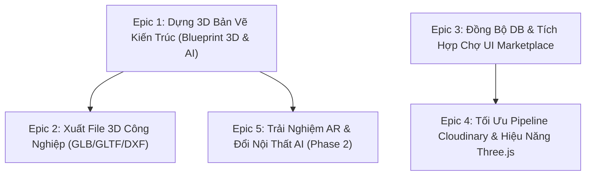
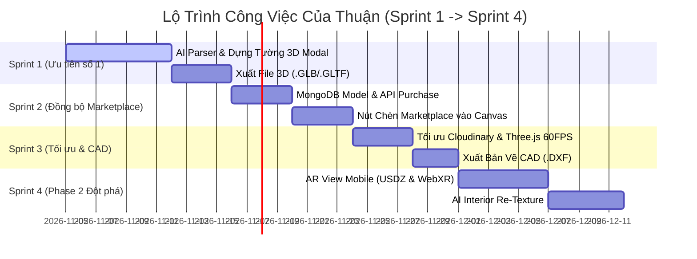

# 📋 Kế Hoạch Triển Khai Chi Tiết — User Stories & Task Breakdown Dành Cho THUẬN

> **Người phụ trách:** Nguyễn Hiệu Thuận (`Goncodex911` / `Gonindex_911`)  
> **Nhánh làm việc:** `thuan-confirm`  
> **Phiên bản tài liệu:** 1.0 — Ngày lập: 05/11/2026  
> **Phạm vi trách nhiệm:** Dựng hình 3D bản vẽ kiến trúc (Blueprint 3D), Xuất file 3D công nghiệp, Chợ UI Marketplace & Tích hợp Canvas, Quản lý Cloudinary Media Pipeline, AR & AI Interior.

---

## 🗺️ Tổng Quan Các Epic

| Epic ID | Tên Epic | Mức độ ưu tiên | Ước tính |
|---|---|---|---|
| **EPIC-01** | Hoàn thiện Phân tích Bản vẽ & Tái tạo Không gian 3D (Blueprint 3D) | 🔥 P0 (Cao nhất) | 2 tuần |
| **EPIC-02** | Xuất Dữ liệu 3D Tiêu Chuẩn Công Nghiệp (`.GLB`, `.GLTF`, `.DXF`) | 🔥 P0 (Cao nhất) | 4 ngày |
| **EPIC-03** | Lưu Trữ DB & Cầu Nối UI Marketplace vào Canvas Editor | 🟡 P1 (Ưu tiên cao) | 1 tuần |
| **EPIC-04** | Tối Ưu Cloudinary Media Pipeline & Hiệu Năng Render Three.js | 🟡 P1 (Ưu tiên cao) | 4 ngày |
| **EPIC-05** | AR View Quét Sàn Thực Tế & AI Interior Re-Texture (Phase 2) | 🔵 P2 (Nâng cao) | 2 tuần |

---

## 🧱 EPIC-01: Hoàn Thiện Phân Tích Bản Vẽ & Tái Tạo Không Gian 3D (Blueprint 3D)

### 📌 Story 1.1: Quét và bóc tách cấu trúc bản vẽ 2D mặt bằng bằng AI
- **Mã:** `STORY-THUAN-01`
- **Mô tả:**  
  *Là một* Kiến trúc sư / Người dùng muốn thiết kế nhà,  
  *Tôi muốn* tải ảnh bản vẽ 2D (PNG, JPG, ảnh chụp giấy vẽ tay) lên hệ thống,  
  *Để* AI tự động nhận dạng chu vi tường chịu lực, chia phòng chức năng, định vị vị trí các cửa đi và cửa sổ chính xác.
- **Tiêu chí chấp nhận (Acceptance Criteria):**
  - [x] Chấp nhận các định dạng ảnh thông dụng dung lượng tối đa 15MB.
  - [ ] AI trả về mảng dữ liệu chuẩn hóa `RoomSpec[]` gồm: tên phòng, tọa độ polygon `(x, y, w, l)`, độ dày tường, và danh sách cửa `doors[]`, cửa sổ `windows[]`.
  - [ ] Hiển thị thanh tiến trình quét thời gian thực (0% → 100%) với các giai đoạn mô tả rõ ràng.
  - [ ] Có cơ chế fallback: nếu AI không nhận diện được ảnh mờ/ảnh lạ, tự động áp dụng cấu trúc lưới chuẩn (Grid layout fallback) và thông báo cho người dùng thay vì báo crash.
- **Công việc phải làm (Tasks):**
  - [ ] **Task 1.1.1:** Hoàn thiện hàm `scanBlueprintWithAI` trong [`frontend/lib/floorplan-ai-scanner.ts`](file:///d:/CODE/PickMe3D/frontend/lib/floorplan-ai-scanner.ts) gửi base64 ảnh tới endpoint Gemini 2.0 Flash với prompt structured JSON.
  - [ ] **Task 1.1.2:** Viết bộ lọc chuẩn hóa dữ liệu đầu ra trong [`frontend/lib/floorplan-analyzer.ts`](file:///d:/CODE/PickMe3D/frontend/lib/floorplan-analyzer.ts), tính toán tỷ lệ scale mét thực tế (Pixels to Meters ratio).
  - [ ] **Task 1.1.3:** Lưu trữ bản vẽ gốc đã nén vào Cloudinary và gắn `originalBlueprintUrl` vào `BlueprintProject`.

---

### 📌 Story 1.2: Dựng tường 3D, khoét lỗ cửa và rải sàn/trần tự động
- **Mã:** `STORY-THUAN-02`
- **Mô tả:**  
  *Là một* Người dùng đang xem bản vẽ thiết kế,  
  *Tôi muốn* chuyển đổi từ góc nhìn 2D sang mô hình 3D khối có chiều cao tường thật, khoét ô cửa đi, cửa sổ và trát sàn gạch/gỗ,  
  *Để* hình dung chân thực không gian sống trước khi thi công.
- **Tiêu chí chấp nhận (Acceptance Criteria):**
  - [ ] Tường 3D được extrude theo chiều cao trần nhà (mặc định 2.8m - 3.2m tùy chỉnh được).
  - [ ] Các vị trí cửa đi được đục thông tường, có khung cửa và cánh cửa gỗ/kính có thể mở góc 45°-90°.
  - [ ] Vị trí cửa sổ được đục tường ở cao độ bậu cửa (mặc định 0.9m) kèm tấm kính trong suốt phản chiếu ánh sáng.
  - [ ] Sàn mỗi phòng có vật liệu riêng biệt (Phòng khách lát đá Marble, Phòng ngủ lát sàn gỗ sồi, WC lát gạch chống trơn).
- **Công việc phải làm (Tasks):**
  - [ ] **Task 1.2.1:** Hoàn thiện thuật toán CSG (Constructive Solid Geometry) hoặc ghép tường phân đoạn (Segmented Walls) trong [`frontend/components/blueprint/CasaSerraViewer.tsx`](file:///d:/CODE/PickMe3D/frontend/components/blueprint/CasaSerraViewer.tsx) để khoét ô cửa mượt mà không lỗi mesh.
  - [ ] **Task 1.2.2:** Xây dựng thư viện vật liệu chuẩn (`Three.MeshStandardMaterial`) có bump map / roughness cho sàn gạch, sàn gỗ, tường sơn trắng, kính cường lực.
  - [ ] **Task 1.2.3:** Tự động sinh nội thất cơ bản mẫu (Sofa phòng khách, Giường ngủ, Bồn rửa WC, Bàn ăn) theo đúng loại phòng đã nhận dạng.

---

### 📌 Story 1.3: Chế độ Walkthrough Góc Nhìn Thứ Nhất (First-Person) & Đo Đạc Kích Thước
- **Mã:** `STORY-THUAN-03`
- **Mô tả:**  
  *Là một* Khách hàng xem nhà,  
  *Tôi muốn* dùng phím W-A-S-D hoặc chạm màn hình để "đi bộ" bên trong ngôi nhà 3D và bật thước đo kích thước các cạnh phòng,  
  *Để* cảm nhận độ rộng rãi và kiểm tra kích thước thực tế từng phòng.
- **Tiêu chí chấp nhận (Acceptance Criteria):**
  - [ ] Hỗ trợ 2 chế độ camera: **Orbit View** (Xoay trên cao/Mặt cắt isometric) và **First-Person View** (Người đi bộ cao 1.65m bên trong nhà).
  - [ ] Va chạm đơn giản (Collision): Camera người đi bộ không đi xuyên qua tường ngoài.
  - [ ] Nút toggle hiển thị kích thước (Dimensions): Hiển thị số đo mét dài x rộng dọc theo các bức tường khi bật.
  - [ ] Minimap 2D thu nhỏ ở góc màn hình hiển thị vị trí và hướng nhìn của người dùng theo thời gian thực.
- **Công việc phải làm (Tasks):**
  - [ ] **Task 1.3.1:** Tích hợp `PointerLockControls` của Three.js kết hợp phím di chuyển W/A/S/D và Joystick ảo cho màn hình cảm ứng điện thoại trong `CasaSerraViewer.tsx`.
  - [ ] **Task 1.3.2:** Viết component `MiniMapOverlay` vẽ canvas 2D 1:1 đồng bộ góc quay camera.
  - [ ] **Task 1.3.3:** Xây dựng lớp vẽ đường kích thước kỹ thuật `DimensionLine3D` bằng `LineSegments2` và text sprite hiển thị số đo (ví dụ: `4.50 m`).

---

## 💾 EPIC-02: Xuất Dữ Liệu 3D Tiêu Chuẩn Công Nghiệp (GLB / GLTF / DXF)

### 📌 Story 2.1: Xuất mô hình 3D sang file `.GLB` / `.GLTF` (Blender, SketchUp, Unity)
- **Mã:** `STORY-THUAN-04`
- **Mô tả:**  
  *Là một* Kiến trúc sư / 3D Designer,  
  *Tôi muốn* tải về toàn bộ mô hình 3D ngôi nhà vừa dựng dưới dạng file nhị phân `.GLB`,  
  *Để* mở trực tiếp trên Blender, SketchUp, 3ds Max hoặc nhập vào game engine Unity/Unreal.
- **Tiêu chí chấp nhận (Acceptance Criteria):**
  - [ ] Nút **"Xuất file 3D (.GLB)"** nằm trên thanh điều khiển của 3D Viewer.
  - [ ] File `.GLB` xuất ra chứa đầy đủ hệ lưới (Meshes), cây phân cấp Nodes (Tường, Cửa, Đồ nội thất) và vật liệu chuẩn PBR (Textures/Colors).
  - [ ] File mở được ngay trên trình xem chuẩn như [gltf-viewer.donmccurdy.com](https://gltf-viewer.donmccurdy.com) mà không bị mất hình hoặc lỗi hướng mặt (Normals).
- **Công việc phải làm (Tasks):**
  - [ ] **Task 2.1.1:** Tích hợp module `three/addons/exporters/GLTFExporter.js` vào [`frontend/components/blueprint/CasaSerraViewer.tsx`](file:///d:/CODE/PickMe3D/frontend/components/blueprint/CasaSerraViewer.tsx).
  - [ ] **Task 2.1.2:** Xây dựng hàm `exportSceneToGLB(scene, options)` tối ưu: chỉ xuất các node kiến trúc và nội thất, bỏ qua helper cameras và ánh sáng phụ.
  - [ ] **Task 2.1.3:** Tự động đặt tên file tải về dạng: `[Ten_Du_An]_3D_PickMe3D_[Timestamp].glb`.

---

### 📌 Story 2.2: Xuất bản vẽ kỹ thuật 2D CAD `.DXF`
- **Mã:** `STORY-THUAN-05`
- **Mô tả:**  
  *Là một* Kỹ sư xây dựng,  
  *Tôi muốn* xuất sơ đồ mặt bằng các phòng và vị trí tim tường thành file `.DXF`,  
  *Để* mở chỉnh sửa tiếp trên phần mềm AutoCAD.
- **Tiêu chí chấp nhận (Acceptance Criteria):**
  - [ ] File `.DXF` tạo ra chứa các layer chuẩn: `WALLS`, `DOORS`, `WINDOWS`, `DIMENSIONS`.
  - [ ] Tọa độ các đường thẳng (POLYLINE / LINE) đúng với kích thước thực tế tính bằng milimet (mm).
- **Công việc phải làm (Tasks):**
  - [ ] **Task 2.2.1:** Viết hàm tiện ích `generateDxfString(rooms: RoomSpec[])` tạo cú pháp mã nguồn DXF tiêu chuẩn (AutoCAD R12/2000 format).
  - [ ] **Task 2.2.2:** Thêm nút xuất **"Bản vẽ CAD (.DXF)"** trong menu Tải về của Blueprint Studio.

---

## 🛒 EPIC-03: Đồng Bộ Database & Tích Hợp Chợ UI Marketplace Vào Canvas

### 📌 Story 3.1: Cơ chế lưu trữ và quản lý bản quyền mua template UI trên MongoDB
- **Mã:** `STORY-THUAN-06`
- **Mô tả:**  
  *Là một* Người dùng đã mua các mẫu UI animation trên Marketplace,  
  *Tôi muốn* các mẫu đã mua được lưu trữ vĩnh viễn trên tài khoản máy chủ của tôi,  
  *Để* khi tôi đổi thiết bị, đăng nhập máy tính mới hay xóa bộ nhớ trình duyệt vẫn không bị mất bản quyền.
- **Tiêu chí chấp nhận (Acceptance Criteria):**
  - [x] Thay thế hoàn toàn cơ chế chỉ lưu tạm ở `localStorage` hiện tại bằng API đồng bộ cơ sở dữ liệu.
  - [x] Tạo bảng lưu đơn hàng mua template trong MongoDB liên kết với `User`.
  - [x] Khi đăng nhập, danh sách template đã mua tự động tải về và hiển thị nhãn `"Đã sở hữu"`.
- **Công việc phải làm (Tasks):**
  - [x] **Task 3.1.1:** Tạo Mongoose Model `MarketplacePurchase.js` trong [`backend/src/models/`](file:///d:/CODE/PickMe3D/backend/src/models/) chứa `{ userId, templateId, price, transactionId, purchasedAt }`.
  - [x] **Task 3.1.2:** Viết Controller và Route `POST /api/marketplace/purchase` và `GET /api/marketplace/my-purchases` có xác thực JWT.
  - [x] **Task 3.1.3:** Cập nhật [`frontend/lib/purchased-animations.ts`](file:///d:/CODE/PickMe3D/frontend/lib/purchased-animations.ts) gọi API backend đồng bộ với bộ nhớ đệm client.

---

### 📌 Story 3.2: Nút 1-Click "Chèn vào Canvas Editor" từ Marketplace
- **Mã:** `STORY-THUAN-07`
- **Mô tả:**  
  *Là một* Designer đang thiết kế giao diện trong Canvas Editor,  
  *Tôi muốn* từ trang Marketplace có thể bấm nút **"Dùng trong Canvas"**,  
  *Để* component animation đó lập tức xuất hiện dưới dạng một widget sống động trong màn hình làm việc của tôi.
- **Tiêu chí chấp nhận (Acceptance Criteria):**
  - [x] Trên từng thẻ template tại [`/ui-marketplace`](file:///d:/CODE/PickMe3D/frontend/app/ui-marketplace/page.tsx), có nút **"Chèn vào Editor"** (bên cạnh nút Copy Code và Download).
  - [x] Khi bấm, nếu đang mở dự án Editor, component tự động được thêm vào cây node Layer hiện tại.
  - [x] Nếu chưa mở dự án nào, tự động mở Editor mới với template đó đặt tại vị trí trung tâm Canvas.
- **Công việc phải làm (Tasks):**
  - [x] **Task 3.2.1:** Xây dựng hàm parser chuyển HTML/CSS của animation thành cấu trúc node `Doc` hoặc `CustomWidgetFrame` trong [`frontend/app/Editor.tsx`](file:///d:/CODE/PickMe3D/frontend/app/Editor.tsx).
  - [x] **Task 3.2.2:** Lưu ID template muốn chèn vào `sessionStorage` (`pending_marketplace_insert`) để Editor tự động nạp khi chuyển trang.

---

## ⚡ EPIC-04: Tối Ưu Cloudinary Media Pipeline & Hiệu Năng Render Three.js

### 📌 Story 4.1: Tối ưu tải ảnh bản vẽ lớn và nén tự động qua Cloudinary
- **Mã:** `STORY-THUAN-08`
- **Mô tả:**  
  *Là một* Người dùng tải lên các bản vẽ dung lượng lớn (10MB - 20MB),  
  *Tôi muốn* hệ thống xử lý nén và tải lên Cloudinary nhanh chóng trong dưới 3 giây mà không làm đơ giao diện.
- **Tiêu chí chấp nhận (Acceptance Criteria):**
  - [ ] Phía client nén trước (client-side pre-compression) ảnh xuống kích thước max 1920px bằng HTML5 Canvas trước khi upload.
  - [ ] Cloudinary tự động chuyển đổi sang định dạng tối ưu WebP/AVIF (`f_auto, q_auto`).
  - [ ] Link ảnh trả về lưu trữ an toàn trong MongoDB.
- **Công việc phải làm (Tasks):**
  - [ ] **Task 4.1.1:** Tối ưu hóa hàm `compressImage` trong [`frontend/lib/floorplan-analyzer.ts`](file:///d:/CODE/PickMe3D/frontend/lib/floorplan-analyzer.ts) sử dụng Web Worker để không nghẽn luồng UI chính.
  - [ ] **Task 4.1.2:** Cập nhật [`backend/src/services/cloudinaryService.js`](file:///d:/CODE/PickMe3D/backend/src/services/cloudinaryService.js) thiết lập cấu hình transform tự động `fetch_format: 'auto'`, `quality: 'auto:good'`.

---

### 📌 Story 4.2: Tối ưu hiệu năng Three.js (FPS 60fps & Giải phóng bộ nhớ RAM)
- **Mã:** `STORY-THUAN-09`
- **Mô tả:**  
  *Là một* Người dùng máy tính cấu hình văn phòng hoặc điện thoại,  
  *Tôi muốn* mô hình 3D xoay lướt mượt mà 60 FPS, không bị nóng máy hay tràn RAM khi xem lâu.
- **Tiêu chí chấp nhận (Acceptance Criteria):**
  - [ ] Duy trì ổn định 55 - 60 FPS trên trình duyệt Chrome/Edge/Safari thông thường.
  - [ ] Khi chuyển trang hoặc đóng viewer, toàn bộ Geometries, Materials và Textures được gọi hàm `.dispose()` đầy đủ, không rò rỉ bộ nhớ (Zero Memory Leak).
- **Công việc phải làm (Tasks):**
  - [ ] **Task 4.2.1:** Áp dụng cơ chế InstancedMesh cho các đối tượng lặp lại (cột nhà, đèn âm trần, ghế đồng dạng).
  - [ ] **Task 4.2.2:** Viết hàm dọn dẹp `cleanupThreeScene(scene, renderer)` trong hook `useEffect` return của `CasaSerraViewer.tsx`.

---

## 🔮 EPIC-05 (Phase 2): Trải Nghiệm AR Trên Điện Thoại & AI Interior Re-Texture

### 📌 Story 5.1: Thực tế tăng cường (AR View) quét sàn phòng thực tế
- **Mã:** `STORY-THUAN-10`
- **Mô tả:**  
  *Là một* Khách hàng muốn xem thực tế,  
  *Tôi muốn* mở điện thoại, quét sàn phòng khách của mình và "đặt" mô hình 3D ngôi nhà thu nhỏ lên sàn thật,  
  *Để* đi vòng quanh ngắm nhìn chân thực nhất qua camera thực tế tăng cường.
- **Tiêu chí chấp nhận (Acceptance Criteria):**
  - [ ] Hiển thị nút **"Xem trong không gian thực (AR)"** kèm mã QR để quét mở trên điện thoại.
  - [ ] Trên iOS (iPhone/iPad): Mở file `.usdz` qua Safari AR Quick Look.
  - [ ] Trên Android: Mở file `.glb` qua Google Scene Viewer / WebXR.
- **Công việc phải làm (Tasks):**
  - [ ] **Task 5.1.1:** Tích hợp `USDZExporter` của Three.js để tự động sinh file AR cho thiết bị Apple.
  - [ ] **Task 5.1.2:** Tích hợp thẻ `<model-viewer ar ar-modes="webxr scene-viewer quick-look">` trên giao diện mobile của viewer.

---

### 📌 Story 5.2: Thay đổi phong cách nội thất bằng AI (AI Interior Re-Texture)
- **Mã:** `STORY-THUAN-11`
- **Mô tả:**  
  *Là một* Gia chủ đang phân vân màu sắc nhà,  
  *Tôi muốn* chọn phòng và bấm chọn phong cách ("Bắc Âu Scandinavian", "Indochine cổ điển", "Tối giản Japandi"),  
  *Để* AI tự động đổi toàn bộ vật liệu sàn gỗ, màu sơn tường và ánh sáng phòng theo đúng phong cách đó trong 3 giây.
- **Tiêu chí chấp nhận (Acceptance Criteria):**
  - [ ] Cung cấp ít nhất 5 bộ preset phong cách nội thất nổi tiếng.
  - [ ] Thay đổi mượt mà màu sắc tường, hoa văn sàn nhà và nhiệt độ màu đèn (Ánh sáng ấm 3000K vs Ánh sáng trắng 5000K).
- **Công việc phải làm (Tasks):**
  - [ ] **Task 5.2.1:** Xây dựng danh mục vật liệu `THEME_MATERIALS_PRESETS` trong `floorplan-types.ts`.
  - [ ] **Task 5.2.2:** Viết hàm `applyInteriorStyle(roomName, style)` chuyển đổi chất liệu 3D động trong `CasaSerraViewer.tsx`.

---

## 📅 Lộ Trình Thực Hiện Từng Tuần (Sprint Plan)

---

## ✅ Checklist Kiểm Tra Định Kỳ Cho Thuận

- [ ] **Độ chính xác của 3D Viewer:** Tường không bị lủng mặt (Normals), cửa đi có thể click để mở/đóng, camera không bị giật lag.
- [ ] **Tính toàn vẹn của File 3D:** File `.GLB` xuất ra mở được trên Blender và Windows 3D Viewer mà không bị mất vật liệu.
- [ ] **Đồng bộ tài khoản:** Mua template xong mở tab ẩn danh hoặc trình duyệt khác đăng nhập vẫn thấy template đã mua.
- [ ] **Bảo mật mã nguồn:** Không hardcode API key Cloudinary hay Gemini vào mã nguồn frontend; toàn bộ thông qua biến môi trường hoặc API backend.

