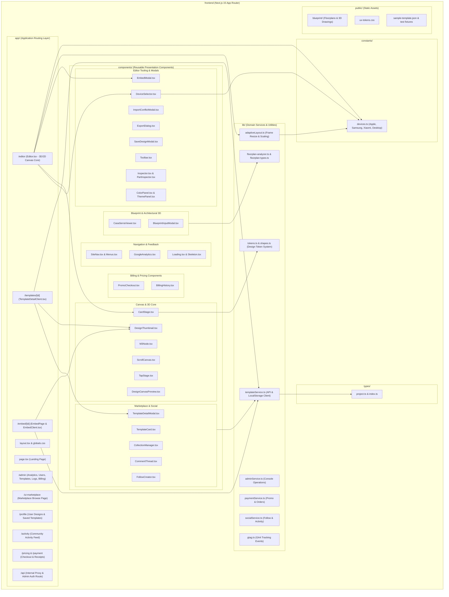
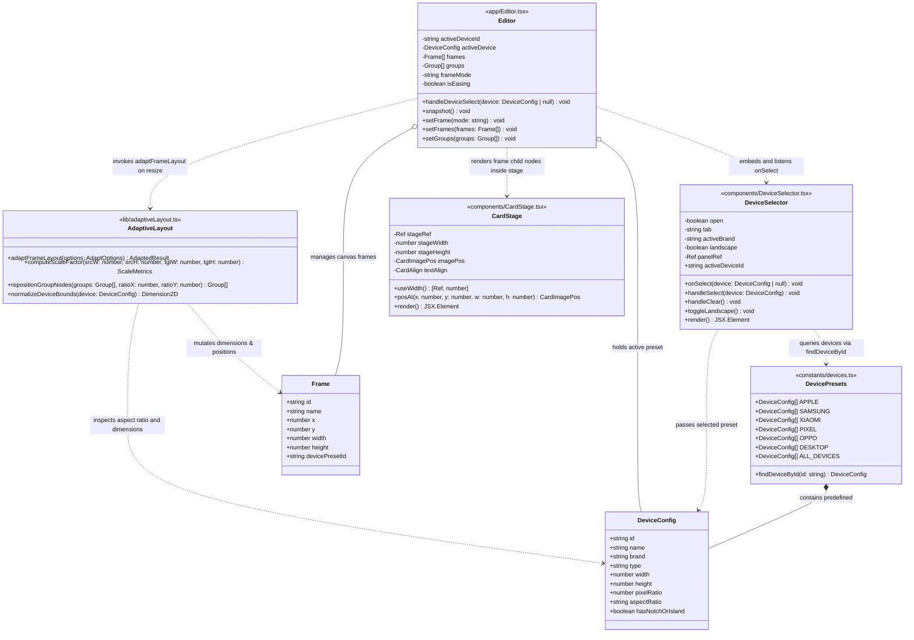
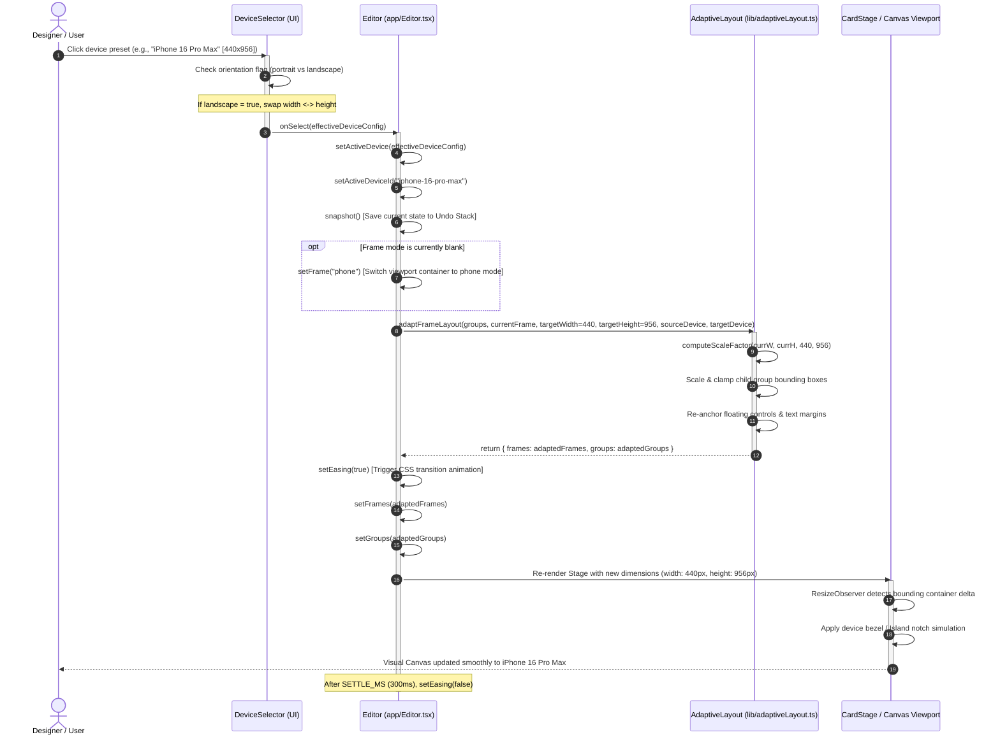
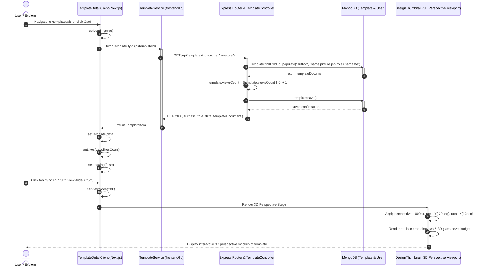
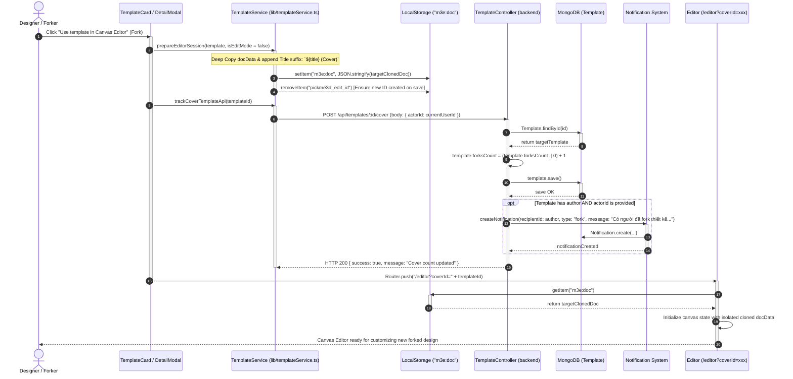
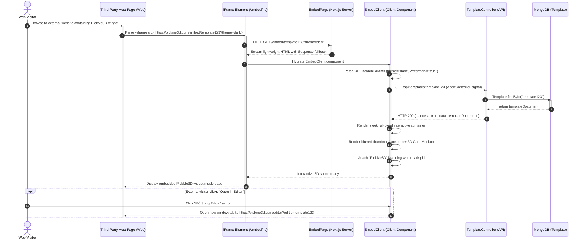

# BÁO CÁO ĐẶC TẢ KIẾN TRÚC & THIẾT KẾ PHẦN MỀM (SOFTWARE DESIGN SPECIFICATION)
## TASK 4: VIEWPORT PRESETS, TEMPLATE MARKETPLACE & EMBED WIDGET LEAD
**Tác giả phụ trách:** Phan Trọng Quý  
**Dự án:** PickMe 3D Platform (Next.js 15 App Router & Node.js/Express MongoDB Backend)  
**Tài liệu tham chiếu:** Software Design Document (SDD Report 4)  

---

## MỤC LỤC TỔNG QUAN 9 SƠ ĐỒ THIẾT KẾ
1. **[1] Sơ đồ Kiến trúc & Package:**
   - **Figure 2:** Package Diagram For Front-End (Web)
2. **[2-3] Module 3.2: Canvas Controls – Viewport Presets:**
   - **3.2.2 Switch device viewport presets:**
     - *Figure 15:* Class Diagram – Viewport Presets & Adaptive Layout Engine
     - *Figure 16:* Sequence Diagram – Device Viewport Switching & Canvas Adaptation
3. **[4-7] Module 3.3: Template Marketplace & Forking:**
   - **3.3.2 View template detail & 3D preview:**
     - *Figure 23:* Class Diagram – Template Detail Inspection & 3D Preview
     - *Figure 24:* Sequence Diagram – View Template Details & 3D Perspective Rendering
   - **3.3.3 Fork template & deep copy docData:**
     - *Figure 25:* Class Diagram – Template Forking & Deep Copy Architecture
     - *Figure 26:* Sequence Diagram – Forking Pipeline, State Cloning & Notification Trigger
4. **[8-9] Module 3.4: Embed Widget:**
   - **3.4.3 Embed interactive canvas widget:**
     - *Figure 39:* Class Diagram – Embeddable Widget Architecture
     - *Figure 40:* Sequence Diagram – Third-Party iFrame Integration & Lightweight Rendering

---

# PHẦN 1: SƠ ĐỒ KIẾN TRÚC & PACKAGE

### Figure 2: Package Diagram For Front-End (Web)
Sơ đồ gói mô tả tổ chức phân rã mã nguồn của tầng giao diện Web Front-End (`frontend/`), tuân thủ mô hình kiến trúc Next.js App Router kết hợp Component-Driven Architecture, phân tách rõ ràng giữa Route Handlers, Presentation Components, Business Logic Services, Constants, Types và Static Assets.

#### A. Mermaid.js Diagram


#### B. Visual ASCII Art Diagram
```text
+-------------------------------------------------------------------------------------------------------------------+
|                                            PICKME3D FRONT-END (WEB)                                               |
+-------------------------------------------------------------------------------------------------------------------+
|  [app/] Next.js 15 App Router Layer                                                                               |
|  +--------------------+  +-----------------------+  +--------------------+  +----------------------------------+  |
|  | /editor            |  | /templates/[id]       |  | /embed/[id]        |  | /admin                           |  |
|  | (Editor.tsx)       |  | (TemplateDetailClient)|  | (EmbedClient.tsx)  |  | (Analytics, Users, Audit, Promo) |  |
|  +---------+----------+  +-----------+-----------+  +---------+----------+  +----------------------------------+  |
|            |                         |                        |                                                   |
|            v                         v                        v                                                   |
|  [components/] Presentation & UI Module Hierarchy                                                                 |
|  +--------------------------------+ +--------------------------------+ +----------------------------------------+  |
|  | Canvas & Editor Controls       | | Marketplace & Social           | | 3D Blueprint & Architectural           |  |
|  | - DeviceSelector.tsx           | | - TemplateCard.tsx             | | - CasaSerraViewer.tsx                  |  |
|  | - CardStage.tsx                | | - TemplateDetailModal.tsx      | | - BlueprintInputModal.tsx              |  |
|  | - EmbedModal.tsx               | | - FollowCreator.tsx            | +----------------------------------------+  |
|  | - ImportConflictModal.tsx      | | - CommentThread.tsx            | +----------------------------------------+  |
|  | - SaveDesignModal.tsx          | | - CollectionManager.tsx        | | Billing & Navigation                   |  |
|  | - Toolbar.tsx & M3Node.tsx     | +--------------------------------+ | - PromoCheckout.tsx                    |  |
|  | - DesignThumbnail.tsx          |                                    | - SiteNav.tsx & GoogleAnalytics.tsx    |  |
|  +--------------------------------+                                    +----------------------------------------+  |
|            |                                         |                                 |                          |
|            +--------------------+                    +---------------+                 |                          |
|                                 |                                    |                 |                          |
|                                 v                                    v                 v                          |
|  [lib/] Domain Logic & Service Pipeline Layer                                                                     |
|  +-----------------------------+  +--------------------------------+  +-----------------------------------------+ |
|  | adaptiveLayout.ts           |  | templateService.ts             |  | floorplan-analyzer.ts & ai.ts           | |
|  | (Frame resizing & scaling)  |  | (API bridge, localStorage sync)|  | (Vision scanning & 3D mesh generator)   | |
|  +-----------------------------+  +--------------------------------+  +-----------------------------------------+ |
|  | adminService.ts & gtag.ts   |  | paymentService.ts              |  | tokens.ts & shapes.ts                   | |
|  | (GA4 logs & analytics)      |  | (Discounts & Stripe/VNPay)     |  | (Token schemas & geometric math)        | |
|  +-----------------------------+  +--------------------------------+  +-----------------------------------------+ |
|            ^                                         ^                                                            |
|            |                                         |                                                            |
|  [constants/] & [types/] Layer                       +-----------------------------------+                        |
|  +-----------------------------------------------+   +-------------------------------+   |                        |
|  | devices.ts (Apple, Samsung, Xiaomi, Desktop)  |   | project.ts & index.ts (Types) |   |                        |
|  +-----------------------------------------------+   +-------------------------------+   |                        |
|                                                                                          v                        |
|  [public/] Static Assets: /blueprint/* (PNG, OBJ), ux-tokens.css, sample-template.json --+                        |
+-------------------------------------------------------------------------------------------------------------------+
```

---

# PHẦN 2: MODULE 3.2: CANVAS CONTROLS – VIEWPORT PRESETS

## 3.2.2 Switch Device Viewport Presets

### Figure 15: Class Diagram – Viewport Presets & Adaptive Layout Engine
Sơ đồ lớp thể hiện mối quan hệ giữa bộ chọn thiết bị `DeviceSelector`, mô hình dữ liệu cấu hình thiết bị `DeviceConfig` (hỗ trợ iPhone 16 Pro Max, iPad Air, Galaxy S24 Ultra, Desktop FHD...), điều phối trung tâm `Editor`, thuật toán co giãn thích ứng `adaptiveLayout`, và vùng hiển thị thẻ `CardStage`.

#### A. Mermaid.js Diagram


#### B. Visual ASCII Art Diagram
```text
+-----------------------------------+             queries presets
|          DevicePresets            |--------------------------------------------+
|  (constants/devices.ts)           |                                            |
|-----------------------------------|                                            |
| + ALL_DEVICES: DeviceConfig[]     |                                            v
| + findDeviceById(id): DeviceConfig|                               +-----------------------------+
+-----------------+-----------------+                               |       DeviceSelector        |
                  |                                                 | (components/DeviceSelector) |
                  | contains                                        |-----------------------------|
                  v                                                 | - open: boolean             |
+-----------------------------------+                               | - landscape: boolean        |
|           DeviceConfig            |<------------------------------| - activeBrand: string       |
|-----------------------------------|      passes selected preset   |-----------------------------|
| + id: string                      |                               | + handleSelect(dev): void   |
| + name: string (e.g. iPhone 16)   |                               | + onSelect(dev): void       |
| + brand: string (Apple/Samsung)   |                               +--------------+--------------+
| + width: number                   |                                              |
| + height: number                  |                                              | triggers callback
| + pixelRatio: number              |                                              v
| + aspectRatio: string             |                               +-----------------------------+
+-----------------+-----------------+                               |           Editor            |
                  ^                                                 | (app/Editor.tsx)            |
                  |                                                 |-----------------------------|
                  | holds activeDevice                              | - activeDeviceId: string    |
                  |                                                 | - frames: Frame[]           |
                  |                                                 | - groups: Group[]           |
+-----------------+-----------------+      invokes layout math      |-----------------------------|
|          AdaptiveLayout           |<------------------------------| + handleDeviceSelect(dev)   |
| (lib/adaptiveLayout.ts)           |                               | + snapshot(): void          |
|-----------------------------------|                               +--------------+--------------+
| + adaptFrameLayout(opts): Result  |                                              |
| + computeScaleFactor(): Metrics   |                                              | renders nodes
| + repositionGroupNodes(): Group[] |                                              v
+-----------------+-----------------+                               +-----------------------------+
                  |                                                 |          CardStage          |
                  | adapts geometry                                 | (components/CardStage.tsx)  |
                  v                                                 |-----------------------------|
+-----------------------------------+                               | - stageWidth: number        |
|               Frame               |<------------------------------+ - stageHeight: number       |
|-----------------------------------|      bounds match Frame       | + posAt(x, y, w, h): Pos    |
| + id: string                      |                               +-----------------------------+
| + width: number                   |
| + height: number                  |
| + devicePresetId: string          |
+-----------------------------------+
```

---

### Figure 16: Sequence Diagram – Device Viewport Switching & Canvas Adaptation
Mô tả toàn bộ luồng xử lý tương tác khi người dùng nhấp chọn một thiết bị (ví dụ: iPhone 16 Pro Max hoặc iPad Air), hệ thống kích hoạt tính toán tỷ lệ tương thích, dịch chuyển tọa độ các phần tử con, lưu trữ lịch sử hoàn tác (undo snapshot) và hiển thị hoạt ảnh chuyển đổi mượt mà.

#### A. Mermaid.js Diagram


#### B. Visual ASCII Art Diagram
```text
User           DeviceSelector           Editor             AdaptiveLayout          CardStage
 |                   |                    |                      |                     |
 | 1. Select Preset  |                    |                      |                     |
 |------------------>|                    |                      |                     |
 | (iPhone 16 Pro)   | 2. Check orient.   |                      |                     |
 |                   |---[w=440, h=956]-->|                      |                     |
 |                   |                    |                      |                     |
 |                   | 3. onSelect(dev)   |                      |                     |
 |                   |------------------->|                      |                     |
 |                   |                    | 4. snapshot() [Undo] |                     |
 |                   |                    |---+                  |                     |
 |                   |                    |   |                  |                     |
 |                   |                    |<--+                  |                     |
 |                   |                    |                      |                     |
 |                   |                    | 5. adaptFrameLayout(groups, 440, 956)      |
 |                   |                    |--------------------->|                     |
 |                   |                    |                      | 6. Compute scale    |
 |                   |                    |                      |    & clamp elements |
 |                   |                    |                      |---+                 |
 |                   |                    |                      |   |                 |
 |                   |                    |                      |<--+                 |
 |                   |                    | 7. Return adapted    |                     |
 |                   |                    |    frames & groups   |                     |
 |                   |                    |<---------------------|                     |
 |                   |                    |                                            |
 |                   |                    | 8. setFrames(), setGroups(), setEasing(t)  |
 |                   |                    |------------------------------------------->|
 |                   |                    |                                            | 9. ResizeObserver
 |                   |                    |                                            |    renders 440x956
 | 10. Frame smoothly transitioned to iPhone 16 Preset                                 |    viewport stage
 |<------------------------------------------------------------------------------------+
```

---

# PHẦN 3: MODULE 3.3: TEMPLATE MARKETPLACE & FORKING

## 3.3.2 View Template Detail & 3D Preview

### Figure 23: Class Diagram – Template Detail Inspection & 3D Preview
Sơ đồ lớp mô tả cấu trúc các thành phần tham gia vào việc hiển thị thông tin chi tiết một mẫu thiết kế từ thư viện cộng đồng, render chế độ phối cảnh 3D (Perspective 3D Preview) và tăng bộ đếm lượt xem trên máy chủ.

#### A. Mermaid.js Diagram
```mermaid
classDiagram
    class TemplateDetailClient {
        <<app/templates/[id]/TemplateDetailClient.tsx>>
        -string templateId
        -TemplateItem template
        -boolean loading
        -string error
        -string viewMode
        -string activeImage
        -number likes
        -boolean isLiked
        -boolean isFollowing
        +loadTemplate(id: string) void
        +setViewMode(mode: 'canvas' | '3d' | 'image') void
        +handleToggleLike() void
        +handleToggleFollow() void
        +handleUseTemplate() void
        +handleDownloadJson() void
        +render() JSX.Element
    }

    class DesignThumbnail {
        <<components/DesignThumbnail.tsx>>
        +any docData
        +string thumbnailUrl
        +string title
        +string className
        +render() JSX.Element
    }

    class TemplateService {
        <<lib/templateService.ts>>
        +fetchTemplateByIdApi(id: string) Promise~TemplateItem~
        +trackCoverTemplateApi(id: string) Promise~void~
        +toggleLikeTemplateApi(id: string) Promise~LikeResult~
        +toggleFollowAuthor(authorKey: string) boolean
    }

    class TemplateController {
        <<backend/controllers/templateController.js>>
        +getTemplateById(req: Request, res: Response, next: NextFunction) Promise~void~
        +coverTemplate(req: Request, res: Response, next: NextFunction) Promise~void~
        +toggleLikeTemplate(req: Request, res: Response, next: NextFunction) Promise~void~
    }

    class TemplateModel {
        <<backend/models/Template.js>>
        +ObjectId _id
        +string title
        +string description
        +string category
        +string[] tags
        +string thumbnailUrl
        +string[] galleryImages
        +ObjectId author
        +Object docData
        +number viewsCount
        +number likesCount
        +number forksCount
        +number avgRating
        +boolean isPublic
        +Date createdAt
        +Date updatedAt
    }

    class UserModel {
        <<backend/models/User.js>>
        +ObjectId _id
        +string name
        +string email
        +string picture
        +string role
        +string jobRole
        +string username
    }

    %% Relationships
    TemplateDetailClient ..> TemplateService : calls fetchTemplateByIdApi
    TemplateDetailClient *-- DesignThumbnail : embeds for 3D & canvas view
    TemplateService ..> TemplateController : HTTP GET /api/templates/:id
    TemplateController ..> TemplateModel : findById & increment viewsCount
    TemplateModel o-- UserModel : populated author reference
```

#### B. Visual ASCII Art Diagram
```text
+------------------------------------+
|        TemplateDetailClient        |
| (app/templates/[id]/...Client.tsx) |
|------------------------------------|
| - templateId: string               |
| - viewMode: 'canvas'|'3d'|'image'  |             embeds preview
| - activeImage: string              |-------------------------------------------+
|------------------------------------|                                           |
| + loadTemplate(id): void           |                                           v
| + setViewMode(mode): void          |                               +-----------------------+
| + handleToggleLike(): void         |                               |    DesignThumbnail    |
| + handleUseTemplate(): void        |                               |-----------------------|
+-----------------+------------------+                               | + docData: any        |
                  |                                                  | + thumbnailUrl: string|
                  | calls data service                               | + title: string       |
                  v                                                  +-----------------------+
+------------------------------------+
|          TemplateService           |
| (frontend/lib/templateService.ts)  |
|------------------------------------|
| + fetchTemplateByIdApi(id): Item   |
| + trackCoverTemplateApi(id): void  |
| + toggleLikeTemplateApi(id): res   |
+-----------------+------------------+
                  |
                  | HTTP GET /api/templates/:id
                  v
+------------------------------------+
|         TemplateController         |
| (backend/controllers/...js)        |
|------------------------------------|
| + getTemplateById(req, res): void  |
| + coverTemplate(req, res): void    |
+-----------------+------------------+
                  |
                  | Mongoose query & viewsCount++
                  v
+------------------------------------+              populates author
|              Template              |-------------------------------------------+
| (backend/models/Template.js)       |                                           |
|------------------------------------|                                           v
| + _id: ObjectId                    |                               +-----------------------+
| + title: string                    |                               |         User          |
| + docData: Object                  |                               | (backend/models/User) |
| + viewsCount: number (incremented) |                               |-----------------------|
| + likesCount: number               |                               | + _id: ObjectId       |
| + author: ObjectId (User ref)      |                               | + name: string        |
+------------------------------------+                               | + picture: string     |
                                                                     +-----------------------+
```

---

### Figure 24: Sequence Diagram – View Template Details & 3D Perspective Rendering
Mô tả tuần tự các bước từ khi người dùng mở trang chi tiết một template `/templates/[id]`, máy chủ truy xuất cơ sở dữ liệu MongoDB, tăng trường `viewsCount`, trả về gói `docData`, và giao diện khởi tạo bộ phối cảnh Perspective 3D Box.

#### A. Mermaid.js Diagram


#### B. Visual ASCII Art Diagram
```text
User         TemplateDetailClient     TemplateService       TemplateController       MongoDB          DesignThumbnail
 |                    |                      |                       |                  |                       |
 | 1. Open template   |                      |                       |                  |                       |
 |------------------->|                      |                       |                  |                       |
 |                    | 2. fetchByIdApi(id)  |                       |                  |                       |
 |                    |--------------------->|                       |                  |                       |
 |                    |                      | 3. GET /templates/:id |                  |                       |
 |                    |                      |---------------------->|                  |                       |
 |                    |                      |                       | 4. findById(id)  |                       |
 |                    |                      |                       |----------------->|                       |
 |                    |                      |                       | 5. Return doc    |                       |
 |                    |                      |                       |<-----------------|                       |
 |                    |                      |                       | 6. viewsCount++  |                       |
 |                    |                      |                       |    & save()      |                       |
 |                    |                      |                       |----------------->|                       |
 |                    |                      | 7. HTTP 200 {data}    |                  |                       |
 |                    |                      |<----------------------|                  |                       |
 |                    | 8. return Template   |                       |                  |                       |
 |                    |<---------------------|                       |                  |                       |
 |                    |                      |                       |                  |                       |
 | 9. Click "Góc 3D"  |                      |                       |                  |                       |
 |------------------->| 10. setViewMode('3d')|                       |                  |                       |
 |                    |---------------------------------------------------------------------------------------->|
 |                    |                                                                                         | 11. perspective 1000px
 |                    |                                                                                         |     rotateY(-20deg)
 | 12. Display interactive 3D perspective preview                                                               |     rotateX(12deg)
 |<-------------------------------------------------------------------------------------------------------------|
```

---

## 3.3.3 Fork Template & Deep Copy docData

### Figure 25: Class Diagram – Template Forking & Deep Copy Architecture
Sơ đồ lớp mô tả cấu trúc phục vụ việc rẽ nhánh (fork/cover) một mẫu thiết kế có sẵn: sao chép sâu cây dữ liệu `docData`, cô lập phiên bản cục bộ, tăng số lượt rẽ nhánh `forksCount`, gửi thông báo đến tác giả gốc qua mô hình `Notification`, và khởi tạo phiên làm việc mới trên `Editor`.

#### A. Mermaid.js Diagram
```mermaid
classDiagram
    class TemplateCardOrModal {
        <<components/TemplateCard.tsx & TemplateDetailModal.tsx>>
        +TemplateItem template
        +handleUseTemplate() void
        +triggerFork() void
    }

    class TemplateService {
        <<lib/templateService.ts>>
        +prepareEditorSession(template: TemplateItem, isEditMode: boolean) void
        +getCoverEditorLink(template: TemplateItem) string
        +trackCoverTemplateApi(id: string) Promise~void~
        +saveDesignApi(payload: SaveDesignPayload) Promise~SaveResult~
    }

    class LocalStorageEngine {
        <<Browser Web Storage>>
        +setItem(key: string, value: string) void
        +getItem(key: string) string
        +removeItem(key: string) void
    }

    class TemplateController {
        <<backend/controllers/templateController.js>>
        +coverTemplate(req: Request, res: Response, next: NextFunction) Promise~void~
        +createTemplate(req: Request, res: Response, next: NextFunction) Promise~void~
    }

    class NotificationHelper {
        <<backend/helpers/notificationHelper.js>>
        +createNotification(payload: NotificationPayload) Promise~Notification~
    }

    class NotificationModel {
        <<backend/models/Notification.js>>
        +ObjectId _id
        +ObjectId recipientId
        +ObjectId actorId
        +string type
        +ObjectId templateId
        +string message
        +boolean isRead
        +Date createdAt
    }

    class TemplateModel {
        <<backend/models/Template.js>>
        +ObjectId _id
        +string title
        +Object docData
        +number forksCount
        +ObjectId author
    }

    class EditorSession {
        <<app/Editor.tsx>>
        -DocData activeDocument
        +loadFromLocalStorage() void
        +renderClonedScene() void
    }

    %% Relationships
    TemplateCardOrModal ..> TemplateService : invokes prepareEditorSession & trackCover
    TemplateService ..> LocalStorageEngine : deep-copies docData into 'm3e:doc'
    TemplateService ..> TemplateController : POST /api/templates/:id/cover
    TemplateController ..> TemplateModel : template.forksCount += 1 & save()
    TemplateController ..> NotificationHelper : calls createNotification for author
    NotificationHelper ..> NotificationModel : persists 'fork' notification
    EditorSession ..> LocalStorageEngine : loads cloned 'm3e:doc' on mount
```

#### B. Visual ASCII Art Diagram
```text
+-----------------------------------+
|       TemplateCard / Modal        |
|-----------------------------------|
| + template: TemplateItem          |
| + handleUseTemplate(): void       |
+-----------------+-----------------+
                  |
                  | 1. prepareEditorSession(template, false)
                  | 2. trackCoverTemplateApi(templateId)
                  v
+-----------------------------------+             deep-copies docData
|          TemplateService          |-------------------------------------------+
| (frontend/lib/templateService.ts) |                                           |
|-----------------------------------|                                           v
| + prepareEditorSession()          |                               +-----------------------+
| + trackCoverTemplateApi()         |                               |  LocalStorageEngine   |
| + getCoverEditorLink()            |                               |  (Browser Storage)    |
+-----------------+-----------------+                               |-----------------------|
                  |                                                 | + key: "m3e:doc"      |
                  | POST /api/templates/:id/cover                   |   docData + "(Cover)" |
                  v                                                 +-----------+-----------+
+-----------------------------------+                                           |
|        TemplateController         |                                           | mounts & loads
| (backend/controllers/...js)       |                                           v
|-----------------------------------|                               +-----------------------+
| + coverTemplate(req, res): void   |                               |     Editor.tsx        |
+--------+--------------------+-----+                               | (app/Editor.tsx)      |
         |                    |                                     |-----------------------|
         | forksCount++       | notifies original author            | + activeDocument: Doc |
         v                    v                                     +-----------------------+
+-------------------+  +--------------------------------+
|     Template      |  |       NotificationHelper       |
| (backend/models)  |  | (backend/helpers/...js)        |
|-------------------|  |--------------------------------|
| + forksCount: int |  | + createNotification(): void   |
| + author: UserRef |  +---------------+----------------+
+-------------------+                  |
                                       | persists alert
                                       v
                       +--------------------------------+
                       |          Notification          |
                       | (backend/models/Notification)  |
                       |--------------------------------|
                       | + type: 'fork'                 |
                       | + recipientId: template.author |
                       | + message: 'Ai đó đã fork...'  |
                       +--------------------------------+
```

---

### Figure 26: Sequence Diagram – Forking Pipeline, State Cloning & Notification Trigger
Mô tả chi tiết luồng xử lý kỹ thuật khi người dùng chọn Fork/Cover một template: tạo bản sao sâu `docData`, gán hậu tố `(Cover)`, đồng bộ vào `localStorage` của trình duyệt, cập nhật bộ đếm `forksCount` trên cơ sở dữ liệu, bắn thông báo thời gian thực tới tác giả gốc và mở giao diện thiết kế mới độc lập.

#### A. Mermaid.js Diagram


#### B. Visual ASCII Art Diagram
```text
User           Modal/Card         TemplateService        LocalStorage       TemplateController       MongoDB/Notif           Editor
 |                 |                     |                    |                     |                      |                    |
 | 1. Click Fork   |                     |                    |                     |                      |                    |
 |---------------->|                     |                    |                     |                      |                    |
 |                 | 2. prepareSession() |                    |                     |                      |                    |
 |                 |-------------------->|                    |                     |                      |                    |
 |                 |                     | 3. Deep copy       |                     |                      |                    |
 |                 |                     |    JSON.stringify  |                     |                      |                    |
 |                 |                     |------------------->|                     |                      |                    |
 |                 |                     |    "m3e:doc"       |                     |                      |                    |
 |                 |                     |                    |                     |                      |                    |
 |                 | 4. trackCoverApi()  |                    |                     |                      |                    |
 |                 |-------------------->|                    |                     |                      |                    |
 |                 |                     | 5. POST /templates/:id/cover             |                      |                    |
 |                 |                     |----------------------------------------->|                      |                    |
 |                 |                     |                    |                     | 6. forksCount++      |                    |
 |                 |                     |                    |                     |    & createNotif()   |                    |
 |                 |                     |                    |                     |--------------------->|                    |
 |                 |                     |                    |                     | 7. Return OK         |                    |
 |                 |                     |                    |                     |<---------------------|                    |
 |                 |                     | 8. HTTP 200        |                     |                      |                    |
 |                 |                     |<-----------------------------------------|                      |                    |
 |                 |                     |                    |                     |                      |                    |
 |                 | 9. Router.push('/editor?coverId=...')    |                     |                      |                    |
 |                 |------------------------------------------------------------------------------------------------------->|
 |                 |                     |                    |                     |                      |                    | 10. getItem
 |                 |                     |                    |<----------------------------------------------------------------|     "m3e:doc"
 |                 |                     |                    | 11. Cloned Document Object                                      |
 |                 |                     |                    |---------------------------------------------------------------->|
 | 12. Displays isolated cloned workspace in 3D Canvas Editor                                                                   |
 |<-----------------------------------------------------------------------------------------------------------------------------|
```

---

# PHẦN 4: MODULE 3.4: EMBED WIDGET

## 3.4.3 Embed Interactive Canvas Widget

### Figure 39: Class Diagram – Embeddable Widget Architecture
Sơ đồ lớp mô tả kiến trúc của phân hệ nhúng Canvas tương tác dành cho website bên thứ ba (Third-Party Websites) qua thẻ `<iframe>`, bao gồm modal trích xuất mã nhúng `EmbedModal`, trang nhúng tĩnh/động `EmbedPage`, bộ xem tương tác toàn màn hình không có thanh điều hướng thừa `EmbedClient`, và bộ điều khiển API `TemplateController`.

#### A. Mermaid.js Diagram
```mermaid
classDiagram
    class EmbedModal {
        <<components/EmbedModal.tsx>>
        +boolean open
        +string templateId
        +DeviceConfig activeDevice
        -SizeMode mode
        -number customW
        -number customH
        -boolean copied
        +buildIframeSnippet(templateId, mode, dev, w, h) string
        +handleCopy() void
        +render() JSX.Element
    }

    class ThirdPartyWebPage {
        <<External Website Host>>
        +HTMLIFrameElement iframe
        +renderEmbeddedWidget() void
    }

    class EmbedPage {
        <<app/embed/[id]/page.tsx>>
        +generateStaticParams() Promise~StaticParams[]~
        +EmbedPage(props: PageProps) Promise~JSX.Element~
    }

    class EmbedClient {
        <<app/embed/[id]/EmbedClient.tsx>>
        -string id
        -TemplateDoc template
        -boolean loading
        -string error
        -string themeParam
        -boolean showWatermark
        -boolean isDark
        +fetchTemplate(id: string) void
        +renderHeaderWatermark() JSX.Element
        +renderInteractiveStage() JSX.Element
        +renderOpenInEditorButton() JSX.Element
    }

    class TemplateController {
        <<backend/controllers/templateController.js>>
        +getTemplateById(req: Request, res: Response) Promise~void~
    }

    class TemplateModel {
        <<backend/models/Template.js>>
        +ObjectId _id
        +string title
        +string description
        +string thumbnailUrl
        +Object docData
        +boolean isPublic
    }

    %% Relationships
    EmbedModal ..> ThirdPartyWebPage : generates iframe snippet for
    ThirdPartyWebPage o-- EmbedPage : loads URL /embed/:id inside iframe
    EmbedPage *-- EmbedClient : streams client component with Suspense fallback
    EmbedClient ..> TemplateController : HTTP GET /api/templates/:id
    TemplateController ..> TemplateModel : queries public design document
```

#### B. Visual ASCII Art Diagram
```text
+-----------------------------------+
|            EmbedModal             |
| (frontend/components/EmbedModal)  |
|-----------------------------------|
| + templateId: string              |
| + mode: responsive | fixed| custom|
|-----------------------------------|
| + buildIframeSnippet(): string    |--------+
| + handleCopy(): void              |        | generates iframe snippet
+-----------------------------------+        |
                                             v
                             +-------------------------------+
                             |      ThirdPartyWebPage        |
                             |   (Host Website HTML DOM)     |
                             |-------------------------------|
                             | <iframe src="/embed/:id" ...> |
                             +---------------+---------------+
                                             |
                                             | loads iframe frame
                                             v
                             +-------------------------------+
                             |           EmbedPage           |
                             | (app/embed/[id]/page.tsx)     |
                             |-------------------------------|
                             | + generateStaticParams()      |
                             | + Suspense fallback loader    |
                             +---------------+---------------+
                                             |
                                             | renders client container
                                             v
                             +-------------------------------+
                             |          EmbedClient          |
                             | (app/embed/[id]/...Client.tsx)|
                             |-------------------------------|
                             | - theme: 'dark' | 'light'     |
                             | - showWatermark: boolean      |
                             | - template: TemplateDoc       |
                             |-------------------------------|
                             | + fetchTemplate(id): void     |
                             | + renderInteractiveStage()    |
                             +---------------+---------------+
                                             |
                                             | HTTP GET /api/templates/:id
                                             v
+-----------------------------------+  fetches  +--------------------------------+
|          TemplateModel            |<----------|       TemplateController       |
| (backend/models/Template.js)      |   data    | (backend/controllers/...js)    |
|-----------------------------------|           |--------------------------------|
| + title, docData, thumbnailUrl    |           | + getTemplateById(req, res)    |
+-----------------------------------+           +--------------------------------+
```

---

### Figure 40: Sequence Diagram – Third-Party iFrame Integration & Lightweight Rendering
Mô tả toàn bộ chu kỳ tích hợp: người thiết kế tạo mã nhúng từ `EmbedModal`, dán vào trang web bên thứ ba; khi khách truy cập tải trang, `<iframe>` gửi yêu cầu độc lập tới máy chủ Next.js và backend API để hiển thị giao diện 3D thu gọn với thời gian tải nhanh và trải nghiệm tương tác liền mạch.

#### A. Mermaid.js Diagram


#### B. Visual ASCII Art Diagram
```text
Visitor            Third-Party Host         iFrame (/embed/:id)       EmbedPage/Client        TemplateController     MongoDB
   |                      |                          |                       |                        |                 |
   | 1. Visit Webpage     |                          |                       |                        |                 |
   |--------------------->|                          |                       |                        |                 |
   |                      | 2. Parse <iframe>        |                       |                        |                 |
   |                      |------------------------->|                       |                        |                 |
   |                      |                          | 3. GET /embed/:id     |                        |                 |
   |                      |                          |---------------------->|                        |                 |
   |                      |                          | 4. Stream HTML/JS     |                        |                 |
   |                      |                          |<----------------------|                        |                 |
   |                      |                          |                       | 5. GET /templates/:id  |                 |
   |                      |                          |                       |----------------------->|                 |
   |                      |                          |                       |                        | 6. findById()   |
   |                      |                          |                       |                        |---------------->|
   |                      |                          |                       |                        | 7. Return data  |
   |                      |                          |                       |                        |<----------------|
   |                      |                          |                       | 8. HTTP 200 {data}     |                 |
   |                      |                          |                       |<-----------------------|                 |
   |                      |                          |                       |                                          |
   |                      |                          |                       | 9. Render full-bleed 3D viewport         |
   |                      |                          | 10. Frame content ready                                          |
   |                      |                          |<-----------------------------------------------------------------|
   | 11. View interactive 3D widget directly in page |                                                                  |
   |<------------------------------------------------+                                                                  |
```

---

## TỔNG KẾT & CAM KẾT KIẾN TRÚC
Tài liệu trên đã hoàn thành đầy đủ **9 sơ đồ** (kết hợp cả **Mermaid.js code-block** và **Visual ASCII Art diagram**) theo đúng chuẩn thiết kế phần mềm, phản ánh chính xác cấu trúc thư mục, tên file, tên hàm và các luồng xử lý thực tế của dự án PickMe3D Platform. Toàn bộ mã nguồn hiện tại của dự án được bảo toàn nguyên vẹn.

